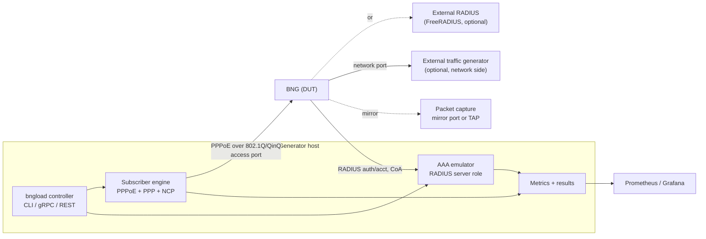
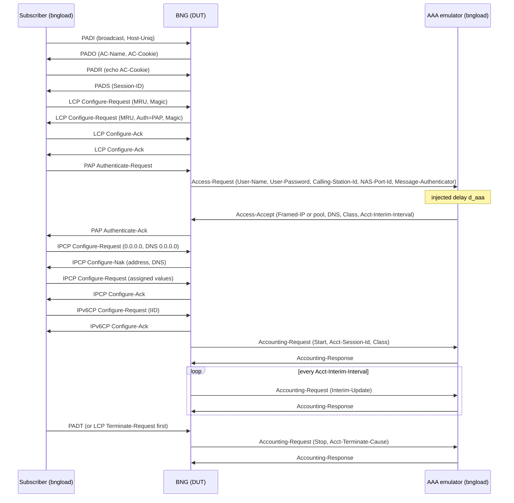
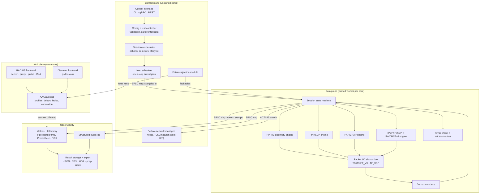
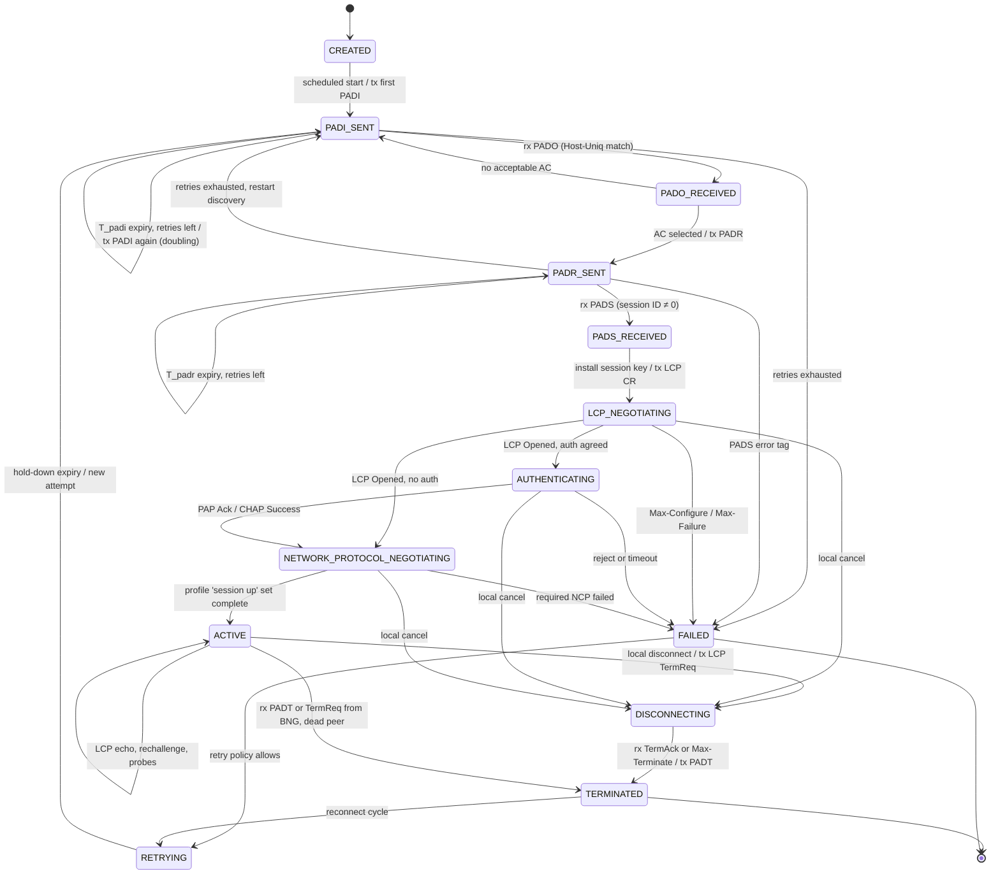
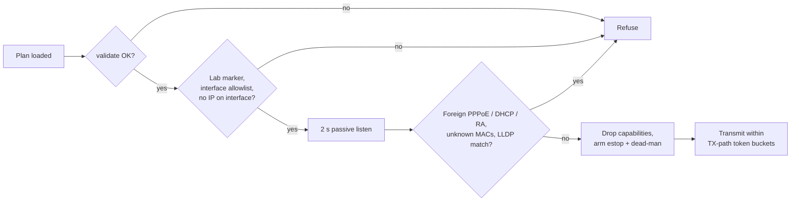
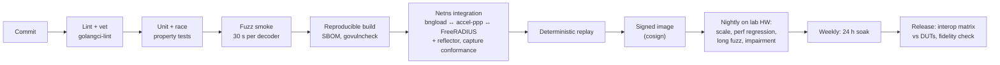
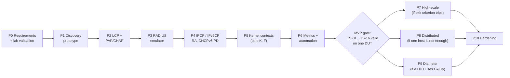

<!-- Snapshot of design draft v0.1 (2026-10-06). The typeset copy is bngload-technical-design.pdf in this directory. Changes to the design go through a pull request that updates both files and, where a decision changes, an ADR in docs/adr/. -->

# PPPoE BNG Workload Generator — Technical Design

Oct 6, 2026 · @Mustafa

## 0. Document control

This is design draft v0.1 for **bngload**, a lab workload generator that emulates PPPoE subscribers toward a BNG and measures session-establishment performance. Audience: network architects, test engineers and the developers who will build it.

**Requirement keywords.** MUST, MUST NOT, SHOULD, SHOULD NOT and MAY are used as defined in BCP 14 (RFC 2119, RFC 8174) only when written in capitals.

**Statement types.** Every normative statement is tagged so readers can tell what is fixed and what is negotiable:

| Tag | Meaning | Can change without re-review? |
| --- | --- | --- |
| **\[REQ\]** | Requirement the system must meet | No |
| **\[DES\]** | Design choice made to satisfy a requirement | Yes, if the requirement still holds |
| **\[ASM\]** | Assumption about the lab, DUT or environment | Must be re-validated if changed |
| **\[REC\]** | Recommendation to operators or test designers | Yes |

**ID scheme.** FR-xxx functional, PR-xxx performance, MR-xxx measurement, SR-xxx safety/security, OR-xxx operational. Scenario IDs are TS-01 to TS-17. State names are in UPPER\_SNAKE\_CASE and match the code and the metric labels.

**Terminology.**

- **DUT** — device under test: the BNG (PPPoE access concentrator with PPP termination, "PTA" mode).
- **Generator / bngload** — the system specified here; it plays the CPE/RG side.
- **Session** — one emulated subscriber: one MAC, one VLAN stack, one PPPoE session ID, one PPP link.
- **Establishment** — the interval from first PADI to the point the session is usable, as defined precisely in section 5.
- **AAA emulator** — the RADIUS server role bngload can optionally play toward the BNG.

**Key assumptions.**

- &#91;ASM-1\] The BNG terminates PPP locally (PTA). L2TP LAC/LNS mode is out of scope for v1 and listed as an extension.
- &#91;ASM-2\] The BNG, not the subscriber, is the RADIUS client (NAS). The generator therefore never sends RADIUS on behalf of a subscriber in a correct topology; it participates in AAA as an emulated server, a passive observer, or a separate load probe (section 2.4).
- &#91;ASM-3\] Tests run on an isolated lab L2 segment between generator and BNG access ports. No production subscribers share that segment.
- &#91;ASM-4\] The generator host runs Linux 5.15 or later. Newer kernels are preferred for AF\_XDP and io\_uring features (section 2.2).
- &#91;ASM-5\] Wall-clock synchronisation between hosts is only needed for cross-host correlation. All latency metrics are measured on one host's monotonic clock.

## Executive summary

bngload should be built in **Go**, with a **user-space PPPoE/PPP stack over AF\_PACKET (TPACKET\_V3) sockets**, sharded across pinned worker threads, and kernel-timestamped packets as the timing source. Per-session Linux network namespaces are an opt-in tier for a few thousand sessions that need real host traffic, not the default.

The headline decisions:

| # | Decision | Why |
| --- | --- | --- |
| D1 | Go for v1; hot path behind a `PacketIO` interface so an AF\_XDP or Rust engine can be added later | Fastest route to a correct, observable tool; kernel timestamps remove most GC/scheduler timing bias |
| D2 | Own PPPoE, LCP, PAP/CHAP, IPCP, IPv6CP codecs and state machines in user space | pppd + kernel PPP costs one process, one netdev and several fds per session and hides the timestamps we need |
| D3 | Every session gets a *logical* network context (MAC, VLAN stack, session ID, IP/prefix, DNS, timers, counters); a *kernel* context (netns + TUN or kernel PPP unit) is optional | Logical contexts scale to 100k+ per host; kernel contexts are capped by netdev and netns cost |
| D4 | The BNG is the RADIUS client. bngload participates in AAA as an **emulated RADIUS server**, a **passive observer**, or a **separate AAA load probe** | Subscribers never speak RADIUS; this is the only way to inject AAA latency and correlate AAA time with PPP time |
| D5 | Diameter is an extension (Gx/Gy server emulation, then NASREQ), not v1 | No IETF profile carries PPPoE subscriber auth over Diameter on mainstream BNGs; RADIUS is the baseline |
| D6 | Latency = difference of kernel or NIC hardware timestamps on one host; open-loop scheduling; HdrHistogram per interval; trial-level confidence intervals | Removes generator queueing, coordinated omission and clock-step bias |
| D7 | Every interval carries a generator-health verdict (schedule lag, socket drops, CPU headroom) and is discarded if the generator was the bottleneck | Separates generator limits from BNG limits |

**MVP scope (phases 0–6):** single host, one physical or SR-IOV port, untagged/802.1Q/QinQ, PPPoE discovery, LCP, PAP and CHAP-MD5, IPCP with DNS, IPv6CP plus DHCPv6-PD over the session, RADIUS server emulator with latency/failure injection, open-loop rate scheduler, scenarios TS-01 to TS-16, Prometheus metrics, JSON/CSV results, safety interlocks.

**Deferred:** distributed multi-node generation, AF\_XDP/DPDK engine, kernel-PPP data-plane tier, MS-CHAPv2/EAP, L2TP LAC/LNS, Diameter.

**Reference point.** The open-source [BNG Blaster](https://github.com/rtbrick/bngblaster) (C, BSD-3) already emulates large PPPoE/IPoE populations with packet\_mmap, raw and DPDK I/O modes. bngload should be benchmarked against it during Phase 0 and reuse its lessons; the reasons to build rather than adopt are tighter AAA correlation, the measurement model in section 5, Kubernetes-native operation and in-house ownership. If those reasons do not hold for your team, extending BNG Blaster is the cheaper path.

## 1. Project objectives and scope

bngload exists to answer one question with defensible numbers: how fast, how reliably and at what scale does this BNG establish PPPoE subscriber sessions, idle and under load.

| ID | Objective | Measurable outcome |
| --- | --- | --- |
| O1 | Generate many concurrent PPPoE sessions | ≥ 64,000 concurrent sessions per generator host in MVP; ≥ 256,000 after Phase 7 |
| O2 | Emulate realistic CPE behaviour | PADI/PADR backoff, LCP/NCP timers and keepalive replies per RFC 2516/1661 and BBF TR-124 defaults; configurable vendor quirks |
| O3 | Measure establishment performance | Every metric in section 5 with defined boundaries, ≤ 50 µs software timestamp error (≤ 10 µs with RX interrupt coalescing off), ≤ 1 µs with NIC hardware stamps |
| O4 | Test idle and loaded BNG | Background session population, churn and data traffic are independent, separately controlled load dimensions |
| O5 | AAA via RADIUS (Diameter where appropriate) | Built-in RADIUS server emulator with per-request latency and failure injection; Diameter as an extension point |
| O6 | Independent network context per session | Logical context always; kernel netns context on demand (section 2.3) |
| O7 | Run in container, VM or bare metal | One static binary and one OCI image; capability set documented per deployment model |
| O8 | Reproducible, automated, statistically meaningful | Deterministic seeds, versioned config, run manifest, repeated trials with confidence intervals |
| O9 | Standards-traceable | Every protocol behaviour mapped to a clause in section 3, vendor-specific behaviour flagged |
| O10 | Safe by default | Target allowlist, rate and session ceilings, dry-run and emergency stop (section 13) |

**Load dimensions.** "Loaded" is ambiguous, so the design treats four load types as independent knobs:

1. **Session population** — sessions already established and held (control-plane state, keepalives, interim accounting).
2. **Churn** — background connect/disconnect rate running alongside the measured sessions.
3. **AAA load** — RADIUS latency and loss imposed by the AAA emulator, or AAA traffic from other NAS clients.
4. **Data-plane load** — traffic through established sessions. Light per-session probes come from bngload; line-rate traffic comes from an external generator fed with bngload's session table.

**Out of scope for v1.** IPoE/DHCP subscribers, L2TP LAC/LNS, PPPoA, multilink PPP, line-rate data-plane generation, lawful intercept, BNG configuration management.

**System context.**



The access port carries only lab traffic. The AAA emulator and the subscriber engine share the generator's clock, which lets AAA time be subtracted from subscriber-observed authentication time (section 5).

## 2. Key design decisions

### 2.1 Implementation language and stack

&#91;DES\] **Go is the v1 language.** Rust wins on latency consistency and memory safety without a GC; Go wins on delivery speed, Linux control-plane libraries, AAA libraries and observability. Because latency is measured from kernel or NIC timestamps (section 5), Go's GC and scheduler affect *capacity* far more than *accuracy*, and capacity is checked by the generator-health gate.

| Criterion | Go | Rust | Edge |
| --- | --- | --- | --- |
| Raw Ethernet frame handling | `x/sys/unix` gives AF\_PACKET, TPACKET\_V3 rings, BPF attach; hand-written codecs are simple | Same syscalls via `libc`/`nix`; zero-copy parsing with lifetimes is natural | Rust, slightly |
| PPPoE scalability | 100k+ sessions fine if sessions are plain structs in pre-allocated slices, not goroutines | 100k+ sessions with no GC cost at all | Rust, slightly |
| Concurrency model | Goroutines and channels; easy sharding; one goroutine per session is a trap (scheduler and GC load) | Threads or async (Tokio); explicit, more verbose, no hidden runtime | Go for velocity |
| Memory safety | Safe except `unsafe` around mmap rings; GC prevents use-after-free | Compile-time safety; `unsafe` confined to ring/FFI code | Rust |
| Throughput and latency consistency | GC pauses typically sub-millisecond; tail jitter from scheduler; mitigated by zero-alloc hot path, `GOMEMLIMIT`, locked threads | Deterministic; no GC; best p99.9 for the generator's own processing | Rust |
| Linux networking integration | `vishvananda/netlink`, `netns` are mature and widely used (Kubernetes CNI plugins) | `rtnetlink`, `nix`; capable but younger | Go |
| Network namespace support | `setns` is per OS thread; requires `runtime.LockOSThread` discipline, a known pitfall | Threads are owned explicitly; straightforward | Rust |
| Development effort | Lower; simpler language, faster onboarding for network engineers | Higher; borrow checker and async add 1.5–2× effort for this kind of code (team estimate, validate) | Go |
| Observability and testing | First-class Prometheus, OpenTelemetry, pprof, race detector, built-in fuzzing (`go test -fuzz`) | Good (`tracing`, `prometheus-client`, `cargo-fuzz`, `proptest`) | Go, slightly |
| Container and bare-metal deployment | Single static binary, tiny image | Single static binary (musl), tiny image | Tie |
| AAA libraries | `layeh.com/radius` (client + server, FreeRADIUS dictionary codegen); `fiorix/go-diameter` (RFC 6733 base, dictionaries) | RADIUS crates exist; no mature Diameter stack | Go, clearly |
| High-performance I/O | AF\_XDP bindings exist but are less mature; DPDK only via cgo | AF\_XDP crates (`afxdp`, `xdp-socket`) usable; DPDK via FFI | Rust |

**Other options considered.**

- **C** — the choice of BNG Blaster and accel-ppp; best raw performance and DPDK access, highest defect risk and slowest feature work. Not recommended for a new team-owned tool unless the AF\_XDP/DPDK engine needs it.
- **C++** — same trade-offs as C with better abstractions; no ecosystem advantage here.
- **Python + Scapy** — excellent for protocol conformance tests and fuzz corpora; unusable for timing or scale. Used only in the test harness.

**Go hot-path rules** \[DES\]:

1. No goroutine per session. A fixed set of *worker* goroutines, each locked to an OS thread and pinned to a core, owns a shard of sessions (shard = hash(MAC) mod N).
2. Each worker runs a run-to-completion loop: drain RX block → demultiplex → advance state machines → batch TX → advance timer wheel.
3. Session state is a pointer-free struct in a pre-allocated slice indexed by a 32-bit slot; lookups use open-addressing tables keyed by `uint64` (MAC + VLAN) and by PPPoE session ID. No heap allocation per packet.
4. Codecs encode into and decode from caller-owned byte slices; a fuzz test asserts zero allocations per packet (`testing.AllocsPerRun`).
5. `GOMEMLIMIT` is set and GC pause and scheduler latency histograms (`runtime/metrics`) are exported every second and feed the generator-health gate.
6. Namespace operations run on dedicated locked threads in the virtual-network manager, never on workers.

**Exit criterion for a second engine.** If, on the reference host, Go workers cannot sustain 3× the DUT's measured maximum setup rate with schedule lag p99 < 1 ms, a Rust or C AF\_XDP engine is built behind the same `PacketIO` and `SessionEngine` interfaces (Phase 7). Control plane, AAA, config and metrics stay in Go.

### 2.2 Packet I/O and virtual networking mechanisms

&#91;DES\] **The wire-facing I/O is AF\_PACKET with PACKET\_MMAP (TPACKET\_V3 RX ring, TX ring or `sendmmsg` batching), fanned out to pinned workers by a BPF steering program keyed on destination MAC.** AF\_XDP is the Phase 7 high-scale engine; DPDK is a contingency. Namespaces, TUN, macvlan and veth are *isolation* tools used only by the optional kernel-context tier, never on the measured control path.

| Mechanism | What it gives bngload | Scale ceiling (order of magnitude, validate in Phase 0) | Timing | Container | Bare metal | Verdict |
| --- | --- | --- | --- | --- | --- | --- |
| AF\_PACKET, plain `recvfrom`/`sendto` | Simplest raw L2 access | \~100–300 kpps per core | Software or HW stamps via `SO_TIMESTAMPING` | Yes, `CAP_NET_RAW` | Yes | Prototype (Phase 1) only |
| AF\_PACKET + TPACKET\_V3 RX ring, TX ring or `sendmmsg` | Zero-copy RX, batched TX, per-frame timestamps in the ring header, `PACKET_FANOUT` multi-worker steering, `PACKET_STATISTICS` drop counters | \~1 Mpps per core; 100k+ sessions | Per-frame SW or HW stamp (`PACKET_TIMESTAMP`) | Yes | Yes | **Default engine** |
| AF\_XDP (XSK) | Near-DPDK rates, NIC stays in kernel, per-queue sockets; needs an XDP program redirecting EtherTypes 0x8863/0x8864 (incl. VLAN-tagged) | Several Mpps per core | HW RX/TX stamps via XDP metadata on recent kernels (roughly 6.3+ RX, 6.8+ TX; verify on target) | Yes, needs `CAP_BPF` + `CAP_NET_ADMIN` and a driver with XDP support | Yes | Phase 7 engine |
| DPDK | Highest rate; full NIC control | 10+ Mpps per core | NIC HW stamps | Hard: hugepages, VFIO, dedicated cores at 100% | Yes | Contingency only |
| io\_uring | Batched syscalls; useful for the RADIUS emulator's UDP sockets and result writing | n/a for L2 (mmap rings already avoid syscalls) | n/a | Often blocked by seccomp defaults | Yes | Optional, Phase 7 |
| TUN | Per-session L3 device for user-space-terminated PPP | \~1–4k devices per host | n/a (not on measured path) | Yes | Yes | Kernel-context tier |
| TAP | L2 device to the kernel | Same as TUN | n/a | Yes | Yes | Not needed |
| macvlan | Per-session MAC on a parent NIC; lets real `pppd` + kernel PPPoE run in a netns | \~1–4k; parent unicast filter overflows to promiscuous | Kernel stack timing only | Yes (macvlan CNI) | Yes | Fidelity tier only (interop baseline with real `pppd`) |
| ipvlan | Shares the parent MAC | n/a | n/a | — | — | **Unsuitable**: each subscriber needs its own MAC |
| veth | Links a netns to a bridge/OVS | \~1–4k pairs | Adds a hop | Yes | Yes | Not on test path; only for management networking |
| Network namespaces | Full per-session IP stack, routing, sockets | \~1–4k per host; creation and teardown are slow (RCU and workqueue bound) | n/a | Nested netns need `CAP_SYS_ADMIN` | Yes | Kernel-context tier only |

**Mechanism by need.**

| Need | Choice |
| --- | --- |
| Low-to-medium scale (≤ 10k sessions, ≤ 1k setups/s) | TPACKET\_V3, 1–2 workers, software timestamps |
| Very high scale (≥ 100k sessions, ≥ 10k setups/s) | TPACKET\_V3 with 4–8 fan-out workers; AF\_XDP engine if the exit criterion in 2.1 trips; data-plane load from an external generator |
| Accurate timing | NIC hardware timestamps (`SOF_TIMESTAMPING_RAW_HARDWARE`) on a PTP-capable NIC; otherwise software stamps with RX interrupt coalescing disabled |
| Containerized deployment | AF\_PACKET on a dedicated interface placed in the pod netns (SR-IOV VF, host-device or macvlan CNI on a dedicated parent); `CAP_NET_RAW`, `CAP_NET_ADMIN` |
| Bare-metal deployment | AF\_PACKET on a dedicated physical port; AF\_XDP or DPDK when needed |

**Mandatory interface settings** \[REQ\]:

- The test interface MUST be in promiscuous mode (`PACKET_MR_PROMISC`). PADO, PADS and session frames are unicast to emulated MACs that the NIC filter would otherwise drop.
- RX VLAN offload SHOULD be disabled (`rxvlan off`, `rx-vlan-stag-hw-parse off`) so tags arrive in-frame. If it cannot be, the engine MUST rebuild the tag stack from `tp_vlan_tci`/`tp_vlan_tpid` auxiliary data.
- `PACKET_QDISC_BYPASS` SHOULD be set on TX sockets to avoid qdisc queuing in the timing path.
- The interface MUST carry no IP address and MUST be excluded from NetworkManager, systemd-networkd, LLDP and IPv6 autoconfiguration to keep stray frames off the access segment.

**Steering.** NICs rarely RSS-hash PPPoE, so hardware queue spreading is unreliable. bngload attaches a classic-BPF or eBPF program with `PACKET_FANOUT_CBPF`/`PACKET_FANOUT_EBPF` that hashes the destination MAC to a worker index. Because MACs are generated per shard, every frame for a session lands on the worker that owns it, and no locks are needed on the hot path.

### 2.3 Session isolation and virtual topology

&#91;DES\] **Every session gets an independent *logical* network context; a *kernel* context is created only for sessions that must run real host applications.** A custom user-space PPP/PPPoE stack is the right base; the Linux kernel PPP stack is kept only as a fidelity cross-check.

**Three isolation tiers.**

| Tier | What a session gets | Data plane | Per-session cost (planning estimate; Phase 0 measures) | Practical ceiling per host | Use |
| --- | --- | --- | --- | --- | --- |
| **L — Logical** (default) | Own MAC, VLAN stack, PPPoE session ID, LCP/NCP state, IPv4 address, IPv6 IID/prefixes, DNS, timers, counters, RNG stream | Synthetic probes (ICMP echo, UDP) built by the engine inside the PPP session | \~1–2 KB user memory; 0 fds; 0 netdevs | 256k+ | All establishment benchmarks |
| **K — Kernel netns** | Tier L plus a network namespace with a TUN device, the negotiated addresses, a default route and resolv.conf | Real sockets (curl, iperf3, DNS) in the netns; engine moves IP packets between TUN and the PPP session | + 1 netns, 2 netdevs (lo, tun), 1 fd; tens to hundreds of KB kernel memory; ms-scale create, slower teardown | \~1–4k | Service verification, QoS spot checks |
| **F — Fidelity** | Real `pppd` with the kernel PPPoE driver over a macvlan, in its own netns | Kernel PPP | + 1 process (\~1–2 MB RSS), 2–3 fds, macvlan + ppp netdevs | \~500–1k | Interop baseline: confirms bngload's timings match a real Linux CPE |

Tier K and F contexts are created *after* the session is ACTIVE and their setup time is recorded separately (`kernel_attach_seconds`). It is never part of establishment latency.

**Virtual topology.**

```mermaid
flowchart TB
  NIC["Test port (PF, SR-IOV VF or vNIC)<br/>promiscuous, VLAN offload off"]
  FAN["AF_PACKET fanout group<br/>eBPF: hash(dst MAC) → worker"]
  NIC --> FAN
  subgraph W0["Worker 0 (core 2)"]
    S0["Sessions MAC 02:b1:00:00:xx:xx<br/>state, timers, counters"]
  end
  subgraph W1["Worker 1 (core 3)"]
    S1["Sessions MAC 02:b1:00:01:xx:xx"]
  end
  subgraph WN["Worker N (core N+2)"]
    SN["Sessions MAC 02:b1:00:NN:xx:xx"]
  end
  FAN --> W0
  FAN --> W1
  FAN --> WN
  subgraph NS["Optional tier K: netns per session"]
    T1["ns sess-000042<br/>tun0 100.64.0.42/32<br/>default via tun0"]
  end
  S0 <-->|"IP ⇄ PPP frames"| T1
```



**Per-session attributes** \[DES\]:

- **MAC address.** Locally administered unicast in the IEEE 802c SLAP *AAI* quadrant (first octet `x2`), laid out as `02:<instance>:<shard-hi>:<shard-lo>:<index-hi>:<index-lo>` by default. Instance ID makes MACs unique across generator nodes; shard bits make steering lock-free. An OUI-based strategy is available for BNGs or access nodes that reject locally administered addresses (vendor-specific; flag in results).
- **VLAN stack.** Generated from a pattern: untagged, single C-tag (0x8100), or QinQ S-tag (0x88A8, or legacy 0x9100 when configured) + C-tag. Supports 1:1 (one C-VLAN per subscriber) and N:1 (many subscribers per VLAN) models from BBF TR-101. PCP and DEI per profile.
- **PPPoE session ID.** Assigned by the BNG. Sessions are keyed by (AC MAC, host MAC, VLAN stack, session ID), because RFC 2516 makes a session ID unique only per MAC pair.
- **IP configuration.** IPv4 address and DNS from IPCP (RFC 1332, RFC 1877). IPv6 link-local from the IPv6CP Interface-Identifier (RFC 5072); global address by SLAAC from a Router Advertisement on the session and/or DHCPv6 IA\_NA; delegated prefix by DHCPv6 IA\_PD (RFC 9915).
- **Routing.** Tier L has an implicit point-to-point route. Tier K installs the address as /32 and a /128 on `tun0`, a default route via `tun0`, and the delegated prefix on a dummy LAN interface if requested.

**Why not the kernel PPP stack by default.**

- It costs one `pppd` process, one ppp netdev and several fds per session; 100k sessions means 100k processes.
- `pppd` hides the per-packet timestamps the measurement model needs, and its timers are tuned for real CPEs, not for controlled experiments.
- Fault injection (drop the third LCP Configure-Ack, delay CHAP Response by 200 ms) and vendor-quirk emulation are hard to express in `pppd`.
- A user-space stack lets one worker own a session end-to-end with no cross-thread locking.

**Scaling limits to watch.**

| Resource | Affects tier | Limit or symptom | Mitigation |
| --- | --- | --- | --- |
| File descriptors | K, F | `ulimit -n`, `fs.file-max`, `fs.nr_open` | Raise to 1M; Tier L uses a constant handful |
| Netdevs | K, F | Creation slows as count grows; sysfs, notifier chains, `ip link` listing time | Cap tier K/F sessions; create from a pre-warmed pool |
| Namespaces | K, F | `user.max_net_namespaces`; asynchronous `cleanup_net` lags under churn, kernel memory grows | Reuse namespaces from a pool instead of delete/create per cycle |
| Kernel memory | K, F | Per-netns sysctl tables, route tables, conntrack | Unload conntrack or set `nf_conntrack_max` low in session netns |
| Neighbour tables | K | `gc_thresh1/2/3` in host netns if traffic is routed | Keep session traffic off the host netns |
| Processes and threads | F | `pid_max`, `kernel.threads-max`, memory | Tier F limited to \~1k sessions |
| Go runtime | L | Heap growth if sessions allocate | Pointer-free session slab, zero-alloc codecs, `GOMEMLIMIT` |
| Socket buffers | L | `tp_drops` in `PACKET_STATISTICS` during bursts | Size RX ring for 2× burst, raise `net.core.rmem_max`, more workers |

### 2.4 AAA design: RADIUS and Diameter

&#91;ASM-2\] restated: **in PPPoE access the BNG is the RADIUS client (NAS) and the subscriber never speaks RADIUS.** "Performing AAA" therefore means bngload controls and observes the AAA side of the BNG, not that subscribers send RADIUS.

**AAA roles** \[DES\]:

| Role | bngload acts as | Purpose | Default |
| --- | --- | --- | --- |
| R1 — AAA emulator | RADIUS server for the BNG (auth 1812/udp, acct 1813/udp) and CoA/Disconnect client (3799/udp, RFC 5176) | Deterministic replies, latency/loss/reject injection, exact AAA-side timestamps, controlled disconnects | **Yes** |
| R2 — AAA proxy | Transparent RADIUS proxy between BNG and a real server (e.g. FreeRADIUS) | Keep real policy while still timestamping and injecting faults | Optional |
| R3 — Passive observer | Decoder on a mirror of the BNG ↔ AAA link | Measure against production-like AAA without being in the path | Optional |
| R4 — AAA load probe | Synthetic NAS (RADIUS client) aimed at the AAA server directly | Find the AAA server's own capacity so it is not mistaken for a BNG limit | Optional, separate run |

**Message flow (PAP, dual-stack).** Exact ordering of Accounting-Start relative to IPCP/IPv6CP completion is vendor-specific and is recorded, not assumed.



**Correlating PPPoE sessions with AAA transactions** \[DES\]. The emulator assigns each subscriber a session UID and resolves every RADIUS packet to it, in this precedence order:

1. **Class (25)** — the emulator puts `bngload:<run-id>:<session-uid>` in Access-Accept. RFC 2865 says the NAS should send Class unmodified in accounting, so Accounting-Start/Interim/Stop map exactly. A BNG that drops Class is flagged.
2. **User-Name (1)** — generated unique per session from the credential template.
3. **Calling-Station-Id (31) + NAS-Port-Id (87)** — the BNG usually renders the subscriber MAC and VLAN here; format is vendor-specific and is parsed by a configurable pattern.
4. **Framed-IP-Address (8)** — fallback for accounting only.

Acct-Session-Id is learnt from the first accounting packet and linked to the UID. Correlation failures are counted (`aaa_uncorrelated_total`) and fail the run above 0.1%.

**RADIUS attributes relevant to PPPoE subscribers.**

| Attribute (type) | Defined in | Seen in | Use in bngload | Level |
| --- | --- | --- | --- | --- |
| User-Name (1) | RFC 2865 | Access-Req, Acct | Identity, correlation | Mandatory |
| User-Password (2) | RFC 2865 | Access-Req (PAP) | PAP check | Mandatory for PAP |
| CHAP-Password (3), CHAP-Challenge (60) | RFC 2865 | Access-Req (CHAP) | CHAP-MD5 check | Mandatory for CHAP |
| NAS-IP-Address (4) / NAS-Identifier (32) | RFC 2865 | All | Identify the BNG, select shared secret | Mandatory (one) |
| NAS-Port (5), NAS-Port-Id (87) | RFC 2865, RFC 2869 | Access-Req, Acct | Port / VLAN identity; format vendor-specific | Recommended |
| NAS-Port-Type (61) | RFC 2865; PPPoE values 32 PPPoEoE, 33 PPPoEoVLAN, 34 PPPoEoQinQ in RFC 4603 | Access-Req | Check the BNG reports the encapsulation correctly | Recommended |
| Service-Type (6) = Framed, Framed-Protocol (7) = PPP | RFC 2865 | Req, Accept | Profile matching | Recommended |
| Calling-Station-Id (31), Called-Station-Id (30) | RFC 2865 | Access-Req, Acct | Subscriber MAC, service; correlation | Recommended |
| Framed-IP-Address (8), Framed-IP-Netmask (9) | RFC 2865 | Accept, Acct | Static IPv4 per subscriber | Optional |
| Framed-Pool (88) | RFC 2869 | Accept | Select BNG-local pool | Optional |
| Framed-MTU (12) | RFC 2865 | Accept | Cap negotiated MRU | Optional |
| Session-Timeout (27), Idle-Timeout (28) | RFC 2865 | Accept | Forced expiry and re-auth tests | Optional |
| Class (25) | RFC 2865 | Accept → Acct | Correlation token | Recommended |
| State (24) | RFC 2865 | Challenge ↔ Req | Multi-round auth (EAP, extension) | Optional |
| Message-Authenticator (80) | RFC 2869, RFC 3579 | All Access-\* | Integrity, BlastRADIUS mitigation | **Mandatory in bngload default profile** |
| Acct-Interim-Interval (85), Event-Timestamp (55) | RFC 2869 | Accept / Acct | Interim accounting load; BNG clock check | Recommended |
| Framed-Interface-Id (96), Framed-IPv6-Prefix (97), Framed-IPv6-Pool (100) | RFC 3162 | Accept | IPv6CP IID, SLAAC prefix | Optional |
| Delegated-IPv6-Prefix (123) | RFC 4818 | Accept, Acct | DHCPv6-PD prefix | Optional |
| Framed-IPv6-Address (168), DNS-Server-IPv6-Address (169), Route-IPv6-Information (170), Delegated-IPv6-Prefix-Pool (171), Stateful-IPv6-Address-Pool (172) | RFC 6911 | Accept | DHCPv6 IA\_NA, IPv6 DNS, pools | Optional |
| MS-Primary/Secondary-DNS-Server (VSA 311/28, 311/29) | RFC 2548 (Informational) | Accept | IPv4 DNS pushed via IPCP 129/131 | Vendor-specific, widely supported |
| Agent-Circuit-Id, Agent-Remote-Id, Actual-Data-Rate-\* (VSA 3561) | RFC 4679 (Informational) | Access-Req, Acct | Line identity from the TR-101 PPPoE tag | Optional, needs IA emulation |
| Acct-Status-Type (40): Start 1, Stop 2, Interim-Update 3, Accounting-On 7, Accounting-Off 8 | RFC 2866 | Acct | Accounting lifecycle | Mandatory |
| Acct-Session-Id (44), Acct-Multi-Session-Id (50) | RFC 2866 | Acct | BNG session key | Mandatory / Optional |
| Acct-Delay-Time (41), Acct-Session-Time (46), Acct-Terminate-Cause (49) | RFC 2866 | Acct | Accounting accuracy checks | Recommended |
| Acct-Input/Output-Octets (42/43), -Packets (47/48), -Gigawords (52/53) | RFC 2866, RFC 2869 | Acct | Counter checks vs probe traffic | Recommended |
| Vendor QoS/service VSAs (Cisco AVPair, Juniper, Nokia, Huawei) | Vendor dictionaries | Accept, CoA | Service activation tests | Vendor-specific |

Dictionaries are loaded from FreeRADIUS-format files so vendor VSAs need no code.

**Retransmission, timeouts, failover, duplicates, load balancing.** These are BNG behaviours; bngload must *tolerate* them as a server and *measure* them, and *implement* them in the R4 probe.

- **Duplicate detection (R1, R2)** \[REQ\]: cache responses keyed by (source IP, source port, Identifier, Request Authenticator) for ≥ 30 s and replay the cached response for duplicates, per RFC 5080. Count retransmissions per session (`aaa_bng_retransmits_total`).
- **Retransmission (R4)** \[DES\]: RFC 5080 back-off (initial 2 s, max 16 s, max 5 retries, max duration 30 s, with jitter), all configurable.
- **Identifier space** \[REQ\]: 256 identifiers per (source IP, source port). The R4 probe opens enough source ports to keep in-flight requests ≤ 200 per port. The emulator accepts any number of BNG source ports.
- **Failover (R1)**: the emulator can run as N independent servers on separate addresses with per-server failure schedules (down, slow, reject-all) to exercise the BNG's dead-server detection and failback. Status-Server (RFC 5997) is answered when enabled. A configurable Access-Reject delay (the deprecating-radius draft recommends about 1 s) lets TS-14 reproduce realistic reject timing.
- **Load balancing (R4)**: round-robin, weighted or hash(User-Name), with per-server health from Status-Server.
- **Emulator implementation**: one `SO_REUSEPORT` UDP socket per core, `recvmmsg`/`sendmmsg` batching, kernel RX timestamps, reply delays scheduled on a timer wheel (never `sleep`), dictionary-driven encoding via `layeh.com/radius`.
- **CoA / Disconnect (R1)**: the emulator sends Disconnect-Request and CoA-Request (RFC 5176, with RFC 8559 proxying considerations) to trigger BNG-initiated teardown and service changes; their round-trip time is a metric.

**Diameter.**

| ISP use of Diameter | Interface | Directly applicable to PPPoE subscriber access? |
| --- | --- | --- |
| Network access auth/authorization/accounting | NASREQ, RFC 7155 (obsoletes RFC 4005), on base RFC 6733 | Yes in principle (it is the Diameter NAS application), but rarely deployed on BNGs |
| Policy control | 3GPP Gx (TS 29.212) between BNG and PCRF | Yes on convergent operators' BNGs; adds per-session CCR-I/CCR-T exchanges |
| Online charging / quota | 3GPP Gy (TS 32.299) or IETF Credit-Control, RFC 8506 (obsoletes RFC 4006) | Yes where prepaid or quota is enforced on the BNG |
| TISPAN NASS location/policy | ETSI ES 283 034 (e4), ES 283 035 (e2) | No — between control functions, not the BNG; historical |

&#91;DES\] Diameter is **not in v1**. The AAA layer is built around an `AAABackend` interface (`Authenticate`, `Authorize`, `AccountingEvent`, `PolicyEvent`) so a Diameter backend can be added in Phase 9 without touching the subscriber engine. The first Diameter target is a **Gx/Gy server emulator** (PCRF/OCS role) because that is where real BNGs use Diameter; NASREQ follows only if a DUT needs it. Transport per RFC 6733: TCP or SCTP on 3868, TLS on 5658, with CER/CEA, DWR/DWA watchdog and DOIC overload control (RFC 7683). `fiorix/go-diameter` is the candidate library.

**AAA security requirements.**

- &#91;SR-1\] RADIUS shared secrets MUST be at least 24 random octets (draft-ietf-radext-deprecating-radius; RFC 2865 only prefers ≥ 16), unique per NAS, loaded from a secret store or a 0600 file, and MUST NOT appear in logs, metrics, results or crash dumps.
- &#91;SR-2\] The emulator MUST put Message-Authenticator as the first attribute of every Access-Accept/Reject/Challenge and, by default, MUST discard Access-Requests without it. This follows the BlastRADIUS (CVE-2024-3596) mitigations in draft-ietf-radext-deprecating-radius (Internet-Draft, not yet an RFC). A legacy profile can relax this for old BNGs and is flagged in results.
- &#91;SR-3\] RadSec is supported as an option: RADIUS/TLS (RFC 6614) and RADIUS/DTLS (RFC 7360) are Experimental and are being replaced by draft-ietf-radext-radiusdtls-bis (Standards Track, still a draft). RADIUS/1.1 (RFC 9765, Experimental) removes MD5 inside TLS and is a Phase 10 option.
- &#91;SR-4\] Where the BNG supports neither RadSec nor Message-Authenticator, RADIUS MUST run on an isolated lab VLAN or over IPsec.
- &#91;SR-5\] Diameter, when added, MUST use TLS (or DTLS/SCTP) or IPsec as RFC 6733 requires for untrusted paths.
- &#91;SR-6\] Subscriber passwords are derived as HMAC(seed-secret, username) rather than stored as lists; PAP User-Password hiding (MD5) is treated as no protection.

### 2.5 PPPoE and PPP implementation

&#91;DES\] bngload implements PPPoE (RFC 2516), the PPP LCP automaton (RFC 1661), PAP, CHAP-MD5, IPCP and IPv6CP itself, plus RS/RA and a DHCPv6 client running *inside* the PPP session for IPv6 addressing and prefix delegation. Note that RFC 2516 and RFC 4638 are **Informational**, not standards-track; they are nonetheless the universal interoperability reference.

**PPPoE framing.** Discovery uses EtherType 0x8863, session stage 0x8864. Header: VER=1, TYPE=1, CODE, SESSION\_ID (16 bits), LENGTH, then TLV tags (discovery) or a 2-octet PPP protocol field and payload (session). There is no HDLC framing, address/control field or FCS in the session stage.

**Discovery.**

| Packet | Code | Direction | Key rules (RFC 2516 unless noted) | bngload behaviour |
| --- | --- | --- | --- | --- |
| PADI | 0x09 | Host → broadcast | Exactly one Service-Name tag; session ID 0; MUST NOT exceed 1484 octets so a relay can add Relay-Session-Id | Host-Uniq carries a 64-bit token (session slot + attempt) for correlation; optional TR-101 Vendor-Specific tag (0x0105) with Agent-Circuit-Id/Remote-Id to emulate an access-node intermediate agent; optional PPP-Max-Payload (RFC 4638) |
| PADO | 0x07 | AC → host (unicast) | Carries AC-Name, Service-Name(s); may carry AC-Cookie | Selection policy: first, by AC-Name, by Service-Name or weighted; records PADO count per PADI (multiple BNGs) |
| PADR | 0x19 | Host → selected AC | Echo AC-Cookie and Relay-Session-Id if received; one Service-Name | Sent to the PADO's source MAC |
| PADS | 0x65 | AC → host | Non-zero session ID on success; Service-Name-Error, AC-System-Error or Generic-Error on failure | Error tags map to failure classes in section 12 |
| PADT | 0xA7 | Either | Session ID of the session; no tags required | Sent on teardown; received PADT terminates immediately with no further PPP |

Session ID 0xFFFF is reserved and MUST NOT be used. Session IDs are unique per (host MAC, AC MAC) pair, not globally.

**Retransmission.** RFC 2516 requires the host to resend PADI (and PADR) when no answer arrives and to *double* the wait each time, but sets no initial value or limit. bngload defaults are below and every value is configurable.

**PPP session establishment.**

| Phase | Protocol (number) | Spec | Requirements and choices |
| --- | --- | --- | --- |
| Link establishment | LCP (0xC021) | RFC 1661, RFC 1570 | Full RFC 1661 automaton (Initial, Starting, Closed, Stopped, Closing, Stopping, Req-Sent, Ack-Rcvd, Ack-Sent, Opened). Options: MRU ≤ 1492 (RFC 2516) unless RFC 4638 negotiated; Magic-Number always (loop detection). MUST NOT request ACCM, ACFC or FCS-Alternatives (RFC 2516); PFC not requested. Unknown options are Configure-Rejected. |
| Keepalive | LCP Echo-Request/Reply | RFC 1661 §5.8 | Always answer BNG echoes with the local magic number. Optional own echoes (interval, miss count) to detect a dead BNG. |
| Authentication | PAP (0xC023) | RFC 1334 (obsoleted by RFC 1994 for CHAP; PAP has no newer spec) | Authenticate-Request with retries on Restart timer; plaintext password. |
|  | CHAP (0xC223), MD5 (algorithm 5) | RFC 1994 | Response = MD5(Identifier ‖ secret ‖ Challenge). MUST handle mid-session rechallenge. |
|  | MS-CHAPv2 (algorithm 0x81), EAP (0xC227) | RFC 2759 (Informational), RFC 3748 | Deferred (extension); note draft-ietf-radext-deprecating-radius deprecates MS-CHAP over unprotected RADIUS. |
| IPv4 network | IPCP (0x8021) | RFC 1332, RFC 1877 | Request IP-Address (3) = 0.0.0.0, Primary DNS (129), Secondary DNS (131); accept Nak'd values; Ack the BNG's own address; reject IP-Compression and NBNS (130/132). |
| IPv6 network | IPv6CP (0x8057) | RFC 5072 (obsoletes RFC 2472) | Interface-Identifier (1) from modified EUI-64 of the MAC or random per profile; accept Nak'd IID; reject IPv6-Compression (RFC 5172). |
| IPv6 addressing | ICMPv6 RS/RA, DHCPv6 | RFC 4861, RFC 4862, RFC 9915 (STD 102, obsoletes RFC 8415), BBF TR-187 | After IPv6CP opens: link-local from IID; RS to ff02::2; SLAAC address if RA carries an autonomous prefix; DHCPv6 Solicit for IA\_PD and/or IA\_NA (Rapid Commit optional) with DUID-LL from the MAC. |
| Data | IPv4 (0x0021), IPv6 (0x0057) | RFC 1661 | Probe traffic in tier L; TUN bridging in tier K. |
| Unsupported | any other | RFC 1661 | Protocol-Reject (e.g. CCP 0x80FD, multilink). |

**IPv6 prefix delegation considerations.**

- BBF TR-187 describes the common model: IPv6CP for the link IID, RA for the WAN /64 (or unnumbered WAN with only PD), DHCPv6-PD for the customer LAN prefix.
- "IPv6 up" is defined per profile: `ipv6cp`, `ipv6cp+ra`, `ipv6cp+pd` or `ipv6cp+ra+pd`. The establishment metric uses that definition, so dual-stack results are always labelled with it.
- PD failures (NoPrefixAvail, timeout) do not fail the IPv4 side; they are reported separately.
- RADIUS Delegated-IPv6-Prefix, Framed-IPv6-Prefix and the RFC 6911 attributes from the emulator drive what the BNG should hand out, so bngload can check that the delegated prefix matches.

**MTU/MRU.** Default MRU 1492, which needs only a standard 1500-byte Ethernet MTU. With RFC 4638, bngload adds PPP-Max-Payload (tag 0x0120) to PADI/PADR; if the AC echoes it in PADO/PADS, LCP may negotiate MRU up to that value (typically 1500, needing ≥ 1508-byte Ethernet MTU on every hop). VLAN tags add 4 or 8 bytes on the wire; the test port MTU MUST cover tag stack + 8 bytes PPPoE/PPP + MRU.

**MAC handling.** One emulated host MAC per session. The AC MAC is learnt from the chosen PADO; session frames from any other MAC are dropped and counted (`rx_foreign_ac_total`).

**VLAN/QinQ.** Tags are written in-frame per session (IEEE 802.1Q C-tag 0x8100, S-tag 0x88A8); RX matches the full stack. PCP for discovery and LCP frames is configurable because some access networks prioritise PPPoE control.

**Termination modes** (selectable per scenario):

| Mode | Sequence | Tests |
| --- | --- | --- |
| Graceful | LCP Terminate-Request → Terminate-Ack → PADT | Normal disconnect, Accounting-Stop timing |
| Abrupt | PADT only | BNG cleanup on PADT |
| Silent | Stop answering; no PADT | BNG LCP-echo dead-peer detection time |
| BNG-initiated | BNG sends Terminate-Request or PADT (e.g. after RADIUS Disconnect-Request) | CoA/DM round trip, client compliance |

**Default timers** \[DES\] (CPE-like, all configurable per profile):

| Timer | Default | Basis |
| --- | --- | --- |
| PADI timeout / retries | 2 s, doubling, max 4 retransmissions (max wait 16 s) | RFC 2516 doubling rule; values bngload-chosen |
| PADR timeout / retries | 2 s, doubling, max 4 | Same |
| LCP Restart / Max-Configure / Max-Terminate / Max-Failure | 3 s / 10 / 2 / 5 | RFC 1661 suggested values |
| PAP/CHAP response wait | 3 s, max 3 attempts | RFC 1661 Restart timer applied |
| IPCP / IPv6CP | Same as LCP | RFC 1661 |
| DHCPv6 SOL\_TIMEOUT / SOL\_MAX\_RT / REQ\_MAX\_RC | 1 s / 3600 s / 10 | RFC 9915 |
| LCP echo (own) | Off; when on, 30 s interval, 3 misses | Typical CPE behaviour (vendor-specific) |
| Session establishment deadline | 30 s | Test policy; session marked FAILED(timeout) |

**Mandatory, optional and vendor-specific behaviour.**

| Mandatory (from the specs) | Optional (spec allows, bngload supports) | Vendor-specific (record, do not assume) |
| --- | --- | --- |
| PADI single Service-Name, ≤ 1484 octets | Host-Uniq | Empty vs named Service-Name matching |
| Echo AC-Cookie and Relay-Session-Id | PPP-Max-Payload, MRU > 1492 | PADO delay / AC selection between redundant BNGs |
| Doubling discovery retransmission | Agent-Circuit-Id/Remote-Id tag (TR-101) | PADI rate limiting per port or MAC |
| No ACCM/ACFC/FCS-Alt in LCP; MRU ≤ 1492 default | LCP echo from CPE | Which side sends LCP Configure-Request first; auth protocol preference order |
| RFC 1661 automaton and Protocol-Reject | MS-CHAPv2, EAP | IPCP DNS via Nak vs Reject |
| Answer LCP Echo-Request | DHCPv6 Rapid Commit | RA timing (unsolicited vs on RS); PD-only vs WAN /64 |
| Session ID 0xFFFF unused | Random vs EUI-64 IID | Accounting-Start timing relative to IPCP/IPv6CP; echo intervals; Calling-Station-Id and NAS-Port-Id formats |

## 3. Standards compliance

The protocol baseline is RFC 2516 + RFC 1661 family for access, RFC 2865/2866/2869/5080 for AAA, IEEE 802.1Q for tagging, and RFC 2544/ETSI NFV-TST 009 principles adapted to session-rate benchmarking. **No IETF, ETSI or BBF document defines a PPPoE session-establishment benchmark**; section 5 defines one and cites where each element comes from.

Compliance levels: **M** mandatory for the stated feature, **R** recommended, **O** optional or extension, **I** informative reference only. Status is the document's own IETF/SDO status as of 2026-10-06.

**IETF — PPPoE and PPP**

| Document | Title | Status | Affects | Level | Relationships |
| --- | --- | --- | --- | --- | --- |
| RFC 2516 | A Method for Transmitting PPP Over Ethernet (PPPoE) | Informational | Discovery engine, framing, PADT | M | Tag registry in RFC 4937 |
| RFC 4638 | Accommodating a Maximum Transit Unit/Maximum Receive Unit (MTU/MRU) Greater Than 1492 in PPPoE | Informational | PPP-Max-Payload, MRU > 1492 | O | Extends RFC 2516 |
| RFC 4937 | IANA Considerations for PPP over Ethernet (PPPoE) | Informational | Codec constants (codes, tags) | R | — |
| RFC 1661 (STD 51) | The Point-to-Point Protocol (PPP) | Internet Standard | LCP automaton, timers, echo, Protocol-Reject | M | Updated by RFC 2153 |
| RFC 1570 | PPP LCP Extensions | Proposed Standard | Handling of extra LCP options | O | Updates RFC 1661 |
| RFC 1334 | PPP Authentication Protocols | Proposed Standard, **obsoleted by RFC 1994** | PAP (still the only PAP definition) | M for PAP | CHAP part superseded by RFC 1994 |
| RFC 1994 | PPP Challenge Handshake Authentication Protocol (CHAP) | Draft Standard | CHAP-MD5 | M for CHAP | Obsoletes RFC 1334 |
| RFC 2759 | Microsoft PPP CHAP Extensions, Version 2 | Informational | MS-CHAPv2 | O (deferred) | — |
| RFC 3748 | Extensible Authentication Protocol (EAP) | Proposed Standard | EAP over PPP | O (deferred) | — |
| RFC 1332 | The PPP Internet Protocol Control Protocol (IPCP) | Proposed Standard | IPCP | M for IPv4 | — |
| RFC 1877 | PPP Internet Protocol Control Protocol Extensions for Name Server Addresses | Informational | DNS options 129/131 | R | — |
| RFC 5072 | IP Version 6 over PPP | Draft Standard | IPv6CP, IID | M for IPv6 | Obsoletes RFC 2472 |
| RFC 5172 | Negotiation for IPv6 Datagram Compression Using IPv6 Control Protocol | Proposed Standard | Reject handling only | O | — |

**IETF — IPv6 subscriber access**

| Document | Title | Status | Affects | Level | Relationships |
| --- | --- | --- | --- | --- | --- |
| RFC 4861 | Neighbor Discovery for IP version 6 (IPv6) | Draft Standard | RS/RA over the session | M for RA modes | — |
| RFC 4862 | IPv6 Stateless Address Autoconfiguration | Draft Standard | SLAAC WAN address | R | — |
| RFC 9915 (STD 102) | Dynamic Host Configuration Protocol for IPv6 (DHCPv6) | Internet Standard | IA\_PD, IA\_NA, timers | M for PD | Obsoletes RFC 8415, which consolidated RFC 3315, 3633, 3736 and others; drops IA\_TA |
| RFC 8106 | IPv6 Router Advertisement Options for DNS Configuration | Proposed Standard | RDNSS from RA | O | — |
| RFC 7084 | Basic Requirements for IPv6 Customer Edge Routers | Informational | CPE behaviour defaults | R | Updated by RFC 9096 |

**IETF — RADIUS**

| Document | Title | Status | Affects | Level | Relationships |
| --- | --- | --- | --- | --- | --- |
| RFC 2865 | Remote Authentication Dial In User Service (RADIUS) | Draft Standard | Emulator, proxy, probe | M | Updated by many, incl. RFC 5080, RFC 9765 |
| RFC 2866 | RADIUS Accounting | Informational | Accounting handling | M | — |
| RFC 2869 | RADIUS Extensions | Informational | Message-Authenticator, Acct-Interim-Interval, NAS-Port-Id, Framed-Pool, Event-Timestamp | R | — |
| RFC 3579 | RADIUS Support For Extensible Authentication Protocol (EAP) | Informational | Message-Authenticator rules | R | — |
| RFC 5080 | Common Remote Authentication Dial In User Service (RADIUS) Implementation Issues and Suggested Fixes | Proposed Standard | Duplicate detection, retransmission | M | Updates RFC 2865, 2866 |
| RFC 5176 | Dynamic Authorization Extensions to RADIUS | Informational | CoA, Disconnect | R | Obsoletes RFC 3576; updated by RFC 8559 |
| RFC 8559 | Dynamic Authorization Proxying in the RADIUS Protocol | Proposed Standard | CoA via proxy mode | O | Updates RFC 5176 |
| RFC 5997 | Use of Status-Server Packets in the RADIUS Protocol | Informational | Server liveness, failover | R | — |
| RFC 3539 | Authentication, Authorization and Accounting (AAA) Transport Profile | Proposed Standard | Failover behaviour in the R4 probe | R | — |
| RFC 3162 | RADIUS and IPv6 | Proposed Standard | Framed-Interface-Id, Framed-IPv6-Prefix, Framed-IPv6-Pool | O | — |
| RFC 4818 | RADIUS Delegated-IPv6-Prefix Attribute | Proposed Standard | PD attribute | O | — |
| RFC 6911 | RADIUS Attributes for IPv6 Access Networks | Proposed Standard | Framed-IPv6-Address, DNS-Server-IPv6-Address, pools | O | — |
| RFC 4603 | Additional Values for the NAS-Port-Type Attribute | Informational | PPPoEoE/PPPoEoVLAN/PPPoEoQinQ checks | R | — |
| RFC 4679 | DSL Forum Vendor-Specific RADIUS Attributes | Informational | Agent-Circuit-Id/Remote-Id VSAs | O | — |
| RFC 2548 | Microsoft Vendor-specific RADIUS Attributes | Informational | MS DNS VSAs | O (vendor) | — |
| RFC 4675 | RADIUS Attributes for Virtual LAN and Priority Support | Proposed Standard | VLAN attributes (rare on BNG) | O | — |
| RFC 8044 | Data Types in RADIUS | Proposed Standard | Codec types | R | — |
| RFC 6929 | Remote Authentication Dial In User Service (RADIUS) Protocol Extensions | Proposed Standard | Extended/long attributes | O | — |
| RFC 6158 (BCP 158) | RADIUS Design Guidelines | Best Current Practice | Dictionary handling | R | — |
| RFC 6613 | RADIUS over TCP | Experimental | Optional transport | O | Updated by RFC 9765 |
| RFC 6614 | Transport Layer Security (TLS) Encryption for RADIUS | Experimental | RadSec | O | To be obsoleted by draft-ietf-radext-radiusdtls-bis |
| RFC 7360 | Datagram Transport Layer Security (DTLS) as a Transport Layer for RADIUS | Experimental | RadSec over UDP | O | Same |
| RFC 9765 | RADIUS/1.1: Leveraging Application-Layer Protocol Negotiation (ALPN) to Remove MD5 | Experimental (Apr 2025) | MD5-free RadSec | O | Updates RFC 2865, 2866, 5176, 6613, 6614, 7360 |
| draft-ietf-radext-radiusdtls-bis | RadSec: RADIUS over TLS and DTLS | Internet-Draft (-18, 30 Sep 2026), in IESG evaluation; intended Proposed Standard | Future RadSec baseline | I (track) | Would obsolete RFC 6614, 7360 |
| draft-ietf-radext-deprecating-radius | Deprecating Insecure Practices in RADIUS | Internet-Draft (-10, 3 Jul 2026), WG document, intended Standards Track | Message-Authenticator mandate (BlastRADIUS) | R (follow) | Not yet an RFC; do not cite as one |

**IETF — Diameter (extension)**

| Document | Title | Status | Affects | Level | Relationships |
| --- | --- | --- | --- | --- | --- |
| RFC 6733 | Diameter Base Protocol | Proposed Standard | Diameter backend | O (Phase 9) | Obsoletes RFC 3588 |
| RFC 7155 | Diameter Network Access Server Application | Proposed Standard | NASREQ | O | Obsoletes RFC 4005 |
| RFC 8506 | Diameter Credit-Control Application | Proposed Standard | Gy-style quota | O | Obsoletes RFC 4006 |
| RFC 7683 | Diameter Overload Indication Conveyance | Proposed Standard | Overload control | O | — |
| 3GPP TS 29.212 / TS 32.299 | Gx policy and charging control / Diameter charging applications (Gy) | 3GPP specifications | PCRF/OCS emulator | O | Vendor BNG profiles vary |

**IETF — Measurement and benchmarking**

| Document | Title | Status | Affects | Level |
| --- | --- | --- | --- | --- |
| RFC 2119, RFC 8174 (BCP 14) | Key words for use in RFCs | BCP | This document | M |
| RFC 1242 | Benchmarking Terminology for Network Interconnection Devices | Informational | Terminology | R |
| RFC 2544 | Benchmarking Methodology for Network Interconnect Devices | Informational (updated by RFC 6201, 6815, 9004) | Trial structure, binary search, trial duration | R (adapted) |
| RFC 6815 | Applicability Statement for RFC 2544: Use on Production Networks Considered Harmful | Informational | Safety section | R |
| RFC 2330 | Framework for IP Performance Metrics | Informational | Clock terms (resolution, skew, offset), metric framework | R |
| RFC 6390 (BCP 170) | Guidelines for Considering New Performance Metric Development | BCP | Metric definition template | R |
| RFC 8219 | Benchmarking Methodology for IPv6 Transition Technologies | Informational | Repeated trials, percentile-based summaries | R |
| RFC 5905 | Network Time Protocol Version 4 | Proposed Standard | Wall-clock sync | R |

**IEEE**

| Document | Title | Affects | Level |
| --- | --- | --- | --- |
| IEEE Std 802.3 | Ethernet | Framing | M |
| IEEE Std 802.1Q | Bridges and Bridged Networks (includes the former 802.1ad provider bridging; S-tag 0x88A8) | VLAN and QinQ | M when tagged |
| IEEE Std 802 + IEEE 802c-2017 | Overview and Architecture; Local Medium Access Control (MAC) Address Usage | MAC generation (SLAP quadrants) | R |
| IEEE Std 1588-2019 | Precision Time Protocol | NIC PHC sync, multi-host timing | R |

**ETSI**

| Document | Title | Status | Affects | Level |
| --- | --- | --- | --- | --- |
| ETSI GS NFV-TST 009 (V3.4.1, 2020-12; check for later) | Specification of Networking Benchmarks and Measurement Methods for NFVI | Group Specification | Search with verification, long-duration trials, test-device calibration, reporting | R (adapted) |
| ETSI GS NFV-TST 001 | Pre-deployment Testing; Report on Validation of NFV Environments and Services | Group Specification (informative report) | Test approach when the BNG is a VNF/CNF | I |
| ETSI GS NFV 002 | Architectural Framework | Group Specification | vBNG terminology | I |
| ETSI ES 283 034 / ES 283 035 | TISPAN NASS e4 / e2 interfaces based on the DIAMETER protocol | ETSI Standard (TISPAN, legacy) | None — between control functions, not the BNG | I (historical) |

ETSI publishes no broadband-access session-establishment benchmark; TST 009 is used for methodology only.

**Broadband Forum and 3GPP**

| Document | Title | Affects | Level |
| --- | --- | --- | --- |
| BBF TR-101 Issue 2 | Migration to Ethernet-Based Broadband Aggregation | 1:1 / N:1 VLAN models, PPPoE Intermediate Agent tag (0x0105, Circuit-ID/Remote-ID sub-options) | R |
| BBF TR-177 | IPv6 in the context of TR-101 | IPv6 access options | O |
| BBF TR-187 | IPv6 for PPP Broadband Access | IPv6CP + RA + DHCPv6-PD model | R |
| BBF TR-124 | Functional Requirements for Broadband Residential Gateway Devices | CPE behaviour defaults | R |
| BBF TR-178 | Multi-service Broadband Network Architecture and Nodal Requirements | Architecture context | I |
| BBF TR-459 Issue 2 | Multi-Service Disaggregated BNG with CUPS | DUT is a CUPS BNG: PPPoE control is redirected UP → CP, so CP placement adds latency | I (R when DUT is DBNG) |
| 3GPP TS 29.244 | Interface between the Control Plane and the User Plane nodes (PFCP) | Observability of DBNG session programming | I |

**Linux behaviour relied on (no formal protocol standard)**

| Source | Behaviour | Design impact |
| --- | --- | --- |
| `packet(7)`, kernel `Documentation/networking/packet_mmap.rst` | TPACKET\_V3 rings, fanout modes, `PACKET_STATISTICS`, `PACKET_QDISC_BYPASS` | Packet I/O engine |
| `Documentation/networking/timestamping.rst` | `SO_TIMESTAMPING`, software vs hardware stamps, TX stamps on the error queue | Measurement model |
| `Documentation/networking/af_xdp.rst` | XSK rings, zero-copy, XDP metadata | Phase 7 engine |
| `network_namespaces(7)`, `setns(2)` | Per-thread namespace membership | Go thread locking, tier K |
| Kernel `pppoe`/`ppp_generic` drivers, `pppd` | Kernel PPP channel and unit model | Tier F fidelity baseline |

## 4. Functional requirements

All requirements below are \[REQ\]. **MVP** items ship by Phase 6; **Later** items by the phase named. Each has a verification method: unit (U), integration against a reference BNG (I), scenario run (S) or inspection (X).

| ID | Area | Requirement | Priority | Verify |
| --- | --- | --- | --- | --- |
| FR-001 | Configuration | Load a versioned YAML/JSON test definition (`apiVersion: bngload/v1`) and reject unknown fields | MVP | U |
| FR-002 | Configuration | Support layered config: defaults ← file ← environment ← CLI flags, with the effective config written to the run manifest | MVP | U |
| FR-003 | Configuration | Reference secrets by name (`secretRef`, file path or env), never inline in result artifacts | MVP | U, X |
| FR-004 | Configuration | Hot-update a whitelisted subset at runtime (rate, ramp target, pause/resume, failure-injection toggles) with each change time-stamped in the event log | MVP | I |
| FR-010 | Profiles | Define named subscriber profiles (auth method, credentials template, IP mode, timers, termination mode, keepalive, quirks) and assign them to session groups by percentage or index range | MVP | U |
| FR-011 | Profiles | Allow multiple profiles in one run (e.g. 70% PAP dual-stack, 30% CHAP IPv4-only) with per-profile metrics | MVP | S |
| FR-020 | Identities | Generate usernames from templates with placeholders (`{index}`, `{index:06d}`, `{shard}`, `{svlan}`, `{cvlan}`, `{mac}`, `{run}`) | MVP | U |
| FR-021 | Identities | Load static identities from CSV (username, password ref, MAC, VLANs, expected IP) for exact-match tests | MVP | U |
| FR-022 | Identities | Derive passwords as HMAC(seed secret, username) when not supplied, so the AAA emulator can verify without a stored list | MVP | U |
| FR-030 | MAC | Generate locally administered unicast MACs in the IEEE 802c AAI quadrant with embedded instance and shard IDs by default | MVP | U |
| FR-031 | MAC | Guarantee uniqueness within a run and across instances that share an access segment; refuse to start on a detected collision | MVP | U, I |
| FR-032 | MAC | Offer OUI-prefixed and CSV strategies; flag non-LAA MACs in the run manifest | MVP | U |
| FR-033 | MAC | Optionally probe the segment at start-up (listen for 2 s) and abort if any generated MAC is already seen | Later (P10) | I |
| FR-040 | VLAN | Generate untagged, single-tag and QinQ stacks from range/step patterns (S-VLAN outer loop, C-VLAN inner loop or vice versa) | MVP | U |
| FR-041 | VLAN | Support 1:1 and N:1 VLAN models with configurable sessions per VLAN | MVP | S |
| FR-042 | VLAN | Configurable outer TPID (0x88A8, 0x8100, 0x9100) and PCP/DEI per tag | MVP | U |
| FR-043 | VLAN | Validate that tag ranges × sessions-per-VLAN ≥ session count before start | MVP | U |
| FR-050 | PPPoE | Implement PADI/PADO/PADR/PADS/PADT per section 2.5 with doubling retransmission | MVP | U, I |
| FR-051 | PPPoE | Support Service-Name selection, AC-Name filtering, AC-Cookie and Relay-Session-Id echo, Host-Uniq correlation | MVP | U |
| FR-052 | PPPoE | Optionally insert the TR-101 Vendor-Specific tag (Agent-Circuit-Id, Agent-Remote-Id, access-loop characteristics) | MVP | U, I |
| FR-053 | PPPoE | Support PPP-Max-Payload (RFC 4638) and MRU > 1492 | MVP (P4) | I |
| FR-054 | PPPoE | Handle PADT from the BNG in any state and release all session resources | MVP | U |
| FR-060 | Auth | PAP and CHAP-MD5 client per RFC 1334/1994 including CHAP rechallenge | MVP | U, I |
| FR-061 | Auth | Accept, Nak or reject the BNG's Auth-Protocol per profile policy (e.g. "CHAP only") | MVP | U |
| FR-062 | Auth | Support deliberately wrong credentials for a configured fraction of sessions | MVP | S |
| FR-063 | Auth | MS-CHAPv2 and EAP-MD5 | Later (P10) | U |
| FR-070 | IP | IPCP with address and DNS negotiation; record assigned values per session | MVP | U, I |
| FR-071 | IP | IPv6CP with EUI-64 or random IID; RS/RA; SLAAC; DHCPv6 IA\_NA and IA\_PD inside the session | MVP | U, I |
| FR-072 | IP | Per-profile IP mode: IPv4-only, IPv6-only, dual-stack; and the "IPv6 up" definition from section 2.5 | MVP | U |
| FR-073 | IP | Verify assigned values against expectations (static IP, prefix length, DNS) and count mismatches | MVP | S |
| FR-074 | IP | Tier K: create a netns with TUN, addresses, routes and resolv.conf for selected sessions | MVP (P5) | I |
| FR-075 | IP | Synthetic per-session probes: ICMP echo to a target, UDP stream with sequence numbers, at a configurable rate | MVP | I |
| FR-080 | RADIUS | AAA emulator (R1) with per-profile replies, attribute templates and FreeRADIUS-format dictionaries | MVP | U, I |
| FR-081 | RADIUS | Accounting server: Start/Interim/Stop/On/Off handling, validation and per-session accounting timeline | MVP | I |
| FR-082 | RADIUS | Duplicate detection and cached replay per RFC 5080 | MVP | U |
| FR-083 | RADIUS | Correlate every RADIUS packet to a session UID (Class, User-Name, Calling-Station-Id + NAS-Port-Id, Framed-IP) | MVP | I |
| FR-084 | RADIUS | CoA-Request and Disconnect-Request to the BNG (RFC 5176), single and bulk | MVP | I |
| FR-085 | RADIUS | Multiple emulator instances on distinct addresses for failover tests | MVP | I |
| FR-086 | RADIUS | Proxy (R2), observer (R3) and load probe (R4) roles | Later (P8) | I |
| FR-087 | RADIUS | RadSec (TLS/DTLS) on the emulator | Later (P10) | I |
| FR-090 | Diameter | `AAABackend` interface stable enough to add a Diameter backend without changes to the subscriber engine | MVP | X |
| FR-091 | Diameter | Gx/Gy server emulator (CCR-I/U/T), then NASREQ | Later (P9) | I |
| FR-100 | Liveness | Answer LCP Echo-Request; optionally send own echoes and declare the BNG dead after N misses | MVP | U |
| FR-101 | Liveness | Measure BNG dead-peer detection time in silent-termination tests | MVP | S |
| FR-110 | Disconnect | Disconnect sessions by selector (all, profile, index range, VLAN, random fraction, list) using any termination mode | MVP | I |
| FR-111 | Reconnect | Reconnect after a configurable hold-down with jitter; count cycles per session | MVP | S |
| FR-120 | Failure injection | Drop, delay, duplicate, reorder or corrupt chosen message types in either direction, by probability, session selector and time window | MVP | U, S |
| FR-121 | Failure injection | Protocol faults: bad Host-Uniq, missing AC-Cookie echo, wrong CHAP response, IPCP Nak loop, ignore Terminate-Request | MVP | U |
| FR-122 | Failure injection | AAA faults: reject, timeout, slow (fixed, uniform, log-normal, empirical distribution), malformed, bad authenticator, server down/up schedule | MVP | U, S |
| FR-130 | Ramp | Ramp up and down by session count or setup rate with linear, step and exponential profiles | MVP | S |
| FR-131 | Steady state | Hold a target population and churn rate for a set duration with Poisson or constant inter-arrival | MVP | S |
| FR-132 | Burst | Release N session attempts within a window W (including W ≈ 0, all PADIs back-to-back) | MVP | S |
| FR-133 | Max sessions | Search for the maximum stable population (stepwise or binary search) with a verification hold | MVP | S |
| FR-134 | Recovery | Mass-disconnect / mass-reconnect after a fault (BNG reload, AAA outage, link flap) and measure time to recover X% of sessions | MVP | S |
| FR-140 | Lifecycle | Cancel a test: stop new attempts, terminate sessions gracefully within a deadline, then abruptly (PADT), then exit | MVP | I |
| FR-141 | Lifecycle | On SIGTERM behave as cancel; on second SIGTERM or emergency stop send PADT for all sessions immediately | MVP | I |
| FR-142 | Lifecycle | Flush metrics and results on any exit path; mark the run `aborted` with reason | MVP | I |
| FR-150 | Validation | `bngload validate` checks schema, ranges, VLAN × MAC capacity, rate ≤ safety ceilings, interface existence, capabilities, target allowlist, kernel features | MVP | U |
| FR-151 | Validation | `--dry-run` resolves the full plan (identities, MACs, VLANs, schedule) and prints a summary without sending frames | MVP | U |
| FR-160 | Reproducibility | One `seed` drives all randomness through per-session RNG streams (seed, session index) so a session's behaviour does not depend on thread scheduling | MVP | U |
| FR-161 | Reproducibility | Run manifest records seed, config hash, binary version and commit, kernel, NIC, driver, firmware, offload settings, CPU pinning, clock source and sync state | MVP | X |
| FR-162 | Reproducibility | Record the offered-load schedule and every injected fault so a run can be replayed exactly (`bngload replay`) | Later (P10) | I |

## 5. Performance, scale and measurement model

Every latency is the difference of two timestamps taken by the kernel or the NIC, on the same host and in the same clock domain. User-space clocks are a labelled fallback. The generator's own processing time is measured and subtracted, and every one-second interval carries a verdict on whether the generator was healthy.

### 5.1 Capacity targets

| ID | Target (reference host: 1 socket, 16 cores, 25/100 GbE NIC with PTP) | MVP | Phase 7 |
| --- | --- | --- | --- |
| PR-1 | Concurrent tier-L sessions per host | ≥ 64,000 | ≥ 256,000 |
| PR-2 | Sustained setup rate per host (dual-stack PAP, healthy generator) | ≥ 5,000/s on 8 workers | ≥ 20,000/s |
| PR-3 | Burst: back-to-back PADIs released | 10,000 within 50 ms | 50,000 within 100 ms |
| PR-4 | Generator think time (RX of trigger → TX of reply), p99 at 50% of PR-2 | < 200 µs | < 100 µs |
| PR-5 | Schedule lag (actual − scheduled first-PADI TX), p99 at 50% of PR-2 | < 1 ms | < 500 µs |
| PR-6 | Memory per tier-L session (amortised, incl. histograms) | ≤ 4 KB | ≤ 2 KB |
| PR-7 | AAA emulator capacity (Access + Accounting, no injected delay) | ≥ 20,000 req/s | ≥ 80,000 req/s |

The exact numbers are planning targets; Phase 0 replaces them with measured values for the chosen hardware.

### 5.2 Timestamps and clocks

**Sources, best first.**

| Source | How obtained | Domain | Typical error | Use |
| --- | --- | --- | --- | --- |
| NIC hardware | `PACKET_TIMESTAMP` with `SOF_TIMESTAMPING_RAW_HARDWARE` (RX, in ring header); `SOF_TIMESTAMPING_TX_HARDWARE` + `OPT_ID` via `MSG_ERRQUEUE` (TX) | NIC PHC | tens of ns | Preferred |
| Kernel software | RX stamp at `netif_receive_skb`; `SOF_TIMESTAMPING_TX_SOFTWARE` at driver hand-off | `CLOCK_REALTIME` | a few µs, plus up to the RX interrupt-coalescing interval | Default |
| User space | `clock_gettime(CLOCK_MONOTONIC)` around syscalls | `CLOCK_MONOTONIC` | tens of µs, scheduler-dependent | Fallback, flagged `ts_source=app` |

**Rules** \[REQ\]:

- MR-1: An interval MUST be computed from two stamps in the same clock domain; each metric records its domain (`hw`, `sw`, `app`). Mixing domains is a bug and fails the run.
- MR-2: During a run the system clock MUST NOT be stepped. chrony is configured with `makestep` only at boot and `maxslewrate` ≤ 100 ppm, bounding slew error to 10 µs per 100 ms of interval. bngload polls `adjtimex` once per second; a step or `TIME_ERROR` state marks the run invalid.
- MR-3: Hardware stamps are used when the NIC supports them on both TX and RX; the PHC may free-run because only intervals are taken (ppm frequency error is negligible at these durations).
- MR-4: Stamps are stored as 64-bit nanoseconds. Reported resolution is 1 µs.
- MR-5: Cross-host intervals (AAA emulator on another host, distributed generation) are only reported when both hosts are PTP-synchronised (IEEE 1588) with a documented offset bound < 10 µs; otherwise AAA-side metrics use the AAA host's own clock only.
- MR-6: RX interrupt coalescing SHOULD be disabled (`ethtool -C <if> rx-usecs 0`) for precision runs and its setting recorded in the manifest. TPACKET\_V3 block-retire timeout is set to ≤ 1 ms; it delays the generator's *reaction* (think time) but not the stamps.

### 5.3 Metric boundaries

Notation: `tx(X)` and `rx(X)` are the TX and RX stamps of packet X at the generator's test port. `X₁` is the first attempt, `Xₖ` the k-th. Host-Uniq embeds the attempt number, so every PADO/PADS is matched to the exact PADI/PADR attempt it answers; LCP/NCP Identifiers do the same for Configure-Request retries.

| Metric | Start | End | Attribution |
| --- | --- | --- | --- |
| `padi_pado_seconds` (offer latency) | tx(PADI₁) | rx(first matching PADO) | DUT, includes retransmission waits |
| `pado_response_seconds` | tx(PADIₖ) | rx(PADO answering attempt k) | DUT response time only |
| `padi_pads_seconds` (discovery) | tx(PADI₁) | rx(PADS, success) | DUT + generator think time |
| `padr_pads_response_seconds` | tx(PADRₖ) | rx(PADS answering attempt k) | DUT |
| `lcp_negotiation_seconds` | first LCP Configure-Request sent or received after PADS | later of rx(Configure-Ack for our request) and tx(Configure-Ack for the BNG's request) | DUT + think |
| `auth_seconds` (PAP) | tx(Authenticate-Request₁) | rx(Authenticate-Ack) | DUT + AAA |
| `auth_seconds` (CHAP) | rx(Challenge) | rx(Success) | DUT + AAA + think |
| `auth_bng_seconds` | tx(PAP request or CHAP Response) | rx(Ack or Success) | DUT + AAA |
| `aaa_access_seconds` (emulator) | rx(Access-Request) at emulator socket | tx(Access-Accept/Reject) | AAA, includes injected delay |
| `auth_bng_overhead_seconds` | `auth_bng_seconds` − `aaa_access_seconds` for the same session | — | DUT only (same host clock) |
| `ipcp_seconds` | rx(auth success), or LCP open if no auth | later of both IPCP Configure-Acks | DUT + think |
| `ipv6cp_seconds` | same start as IPCP | later of both IPv6CP Configure-Acks | DUT + think |
| `ra_seconds` | IPv6CP open | rx(RA with usable prefix) | DUT |
| `dhcpv6_pd_seconds` | tx(Solicit₁) | rx(Reply with IA\_PD) | DUT (+ AAA if PD comes from RADIUS) |
| `establish_seconds` (end-to-end) | tx(PADI₁) | last event required by the profile's "session up" definition | DUT + AAA + think |
| `establish_bng_seconds` | `establish_seconds` − Σ generator think times on the session | — | DUT + AAA |
| `establish_from_schedule_seconds` | scheduled start time | same end as `establish_seconds` | Detects generator queueing (coordinated omission) |
| `acct_start_delay_seconds` | session up at subscriber | rx(Accounting-Request Start) at emulator | DUT accounting pipeline |
| `teardown_seconds` (graceful) | tx(LCP Terminate-Request) | rx(Terminate-Ack) | DUT |
| `dm_teardown_seconds` | tx(Disconnect-Request) at emulator | rx(PADT or Terminate-Request) at subscriber | DUT |
| `acct_stop_delay_seconds` | session down at subscriber | rx(Accounting-Request Stop) at emulator | DUT |
| `dead_peer_detect_seconds` | last frame answered by the silenced subscriber | rx(PADT) or Accounting-Stop | DUT keepalive policy |

**Counters and rates.**

| Metric | Definition |
| --- | --- |
| `sessions_attempted_total` | Sessions that sent PADI₁, by profile |
| `sessions_established_total`, `sessions_failed_total{class}` | Sessions reaching ACTIVE / FAILED, by failure class (section 12) |
| Setup rate, success rate, failure rate | Per-second deltas of the above, bucketed by *completion* time |
| `discovery_completion_ratio` | PADS successes ÷ PADI₁ sent, per interval |
| `sessions_active` | Gauge of sessions in ACTIVE |
| `retransmits_total{msg}` | PADI, PADR, LCP-CR, PAP, IPCP-CR, IPv6CP-CR, Solicit, Request retransmissions |
| `timeouts_total{phase}` | Phase deadlines exceeded |
| `padt_total{dir,state}` | PADT sent/received, by session state at the time |
| `aaa_requests_total{type,result}`, `aaa_bng_retransmits_total` | AAA counts, BNG retransmissions seen |

**Host and runtime metrics** (1 s interval): per-core CPU (busy, softirq, steal), RSS and Go heap, interface bps and pps (TX/RX), ring `tp_packets`/`tp_drops`/`tp_freeze_q_cnt`, NIC `rx_missed`/`rx_no_buffer` counters via ethtool, `/proc/net/softnet_stat` drops and time-squeeze, `sendmsg` errors (`ENOBUFS`, `EAGAIN`), Go GC pause and scheduler-latency histograms from `runtime/metrics`, timer-wheel lag, schedule lag.

**Resource-exhaustion thresholds** are reported as the population or setup rate at which each health signal first crosses its limit, for both generator and DUT-side symptoms (rising PADO latency, PADS errors, AAA timeouts).

### 5.4 Histograms and statistics

- **Recording.** Each worker keeps one HdrHistogram per latency metric per one-second interval: 1 µs to 600 s range, 3 significant digits (≤ 0.1% value error). The aggregator swaps and merges worker histograms at interval boundaries without locks on the hot path. Interval and cumulative histograms are both kept and the cumulative one is serialised into results (HDR log format) so any percentile can be recomputed later.
- **Reported statistics** per metric, per profile, per interval and per trial: count, min, mean, p50 (median), p90, p95, p99, p99.9, max, error rate. Prometheus exposure uses native or exponential-bucket histograms for dashboards only; the HDR results are authoritative.
- **Failures and timeouts are never dropped.** Latency percentiles are reported over successful sessions *and*, separately, over all attempts with failures censored at the deadline (`establish_seconds_censored`). The success ratio uses a Wilson 95% score interval.
- **Warm-up and cool-down.** Steady-state statistics exclude the first `warmup` (default 10 s or 1,000 sessions) and last `cooldown` seconds of the hold phase.
- **Repetition and confidence intervals.** Session latencies within one trial are correlated through shared DUT state, so they are *not* treated as independent samples. Each trial yields one value per statistic; a test repeats ≥ 5 trials (≥ 20 for published results, following the repeated-trial practice in RFC 2544 and RFC 8219). The reported value is the median across trials with a 95% bootstrap percentile interval (10,000 resamples); means use a Student-t interval. Maxima are reported as the range across trials, without a CI.
- **Comparisons** (firmware A vs B) use a Mann-Whitney U test on trial-level medians and p99s, reported with effect size, not only a p-value.

### 5.5 Avoiding measurement bias

| Bias | Countermeasure |
| --- | --- |
| Coordinated omission (closed-loop generator hides DUT stalls) | Open-loop schedule computed in advance from the seed; `establish_from_schedule_seconds` reported beside `establish_seconds` |
| Generator think time inflating DUT latency | Think time measured per exchange and subtracted for `*_bng_*` metrics; reported as its own histogram |
| Retransmission ambiguity | Attempt number in Host-Uniq and per-attempt LCP/NCP Identifiers; per-attempt response metrics |
| Survivorship (only fast sessions counted) | Censored percentiles and failure classes always reported |
| Clock steps and slew | MR-2 interlock; hardware stamps preferred |
| Logging and telemetry on the hot path | Lock-free per-worker counters; event logs via a bounded ring drained by a separate core; high-performance mode drops debug events and counts the drops |
| NIC interrupt coalescing and ring delays | MR-6; coalescing settings in the manifest |
| Cohort mixing (background vs measured sessions) | Every session carries a `cohort` label; background population is never in the measured histograms |
| DUT warm state (caches, pools) | Record DUT uptime and prior test; optional DUT reset hook between trials; randomise trial order across profiles |
| Timer-wheel granularity | 1 ms tick only schedules generator actions; it never affects stamps. Schedule lag is measured against it |

### 5.6 Separating generator limits from BNG limits

1. **Calibrate the generator first.** Run TS-16 against bngload's built-in *reflector* (a minimal PPPoE AC + PPP + IPCP/IPv6CP responder) on a second host or a back-to-back cable. The highest setup rate and population with a healthy gate is the generator ceiling for that host.
2. **Operate below one third of the ceiling.** A DUT result is labelled *valid* only when the offered load is ≤ ⅓ of the calibrated ceiling and the health gate passed for every interval used.
3. **Health gate per interval** (defaults, configurable): schedule lag p99 < 1 ms; think time p99 < 200 µs; ring and softnet drops = 0; `ENOBUFS` = 0; any worker > 70% busy fails; GC pause p99 < 1 ms; AAA emulator own processing p99 < 1 ms excluding injected delay. A failing interval is tagged `GEN_LIMITED` and excluded from DUT statistics.
4. **Capacity-invariance check.** If doubling generator workers or instances changes the DUT result by more than the CI width, the earlier result was generator-limited.
5. **AAA separation.** AAA time is subtracted (`auth_bng_overhead_seconds`). When an external AAA server is used, run the R4 probe first to establish its capacity and keep the test below half of it.
6. **Path separation.** Use a direct cable or a switch whose drop counters are captured before and after each trial; any switch drop invalidates the trial.

## 6. Load-test methodology

Every scenario is a trial template run ≥ 5 times (section 5.4). **Success criteria** decide whether a trial is a valid measurement; **pass/fail criteria** judge the DUT. DUT thresholds are parameters the operator sets from its SLA; the defaults below are starting points.

**Common procedure for every trial.**

1. Pre-checks: DUT session count = 0 (via optional DUT hook or operator confirmation), AAA reachable, clock sync healthy (MR-2), interface settings match the manifest, capture armed if requested.
2. Run the scenario's phases: warm-up → measured phase → cool-down.
3. Teardown: graceful disconnect of all sessions, wait for all Accounting-Stops (max 60 s), PADT any stragglers.
4. Post-checks: DUT session count back to 0, no orphan accounting, switch drop counters unchanged.
5. Verdict: health gate over all measured intervals, then DUT pass/fail.

**Default DUT parameters** (override per test plan): `R_max` = DUT setup rate found by TS-04; `N_max` = DUT licensed or found maximum sessions; `T_est` = establishment p99 target (default 1 s with zero AAA delay); `deadline` = 30 s per session.

#### TS-01 Baseline, single session

- **Purpose:** protocol conformance and the unloaded latency floor.
- **Inputs / configuration:** 1 session per profile (PAP IPv4, CHAP dual-stack + PD); 1 worker; hardware stamps if available; AAA delay 0.
- **Traffic pattern / ramp:** connect → hold 10 s with ICMP probe at 1/s → graceful disconnect; 100 sequential iterations, 1 s apart; no ramp.
- **Duration:** \~5 min.
- **Success:** 100 iterations complete; health gate passes; packet capture recorded.
- **Metrics:** every phase latency, think time, `aaa_access_seconds`, `acct_start_delay_seconds`, teardown, probe RTT.
- **Expected failure modes:** Service-Name or auth-protocol mismatch, MRU disagreement, DNS not offered, IPv6 RA not sent without RS.
- **Pass/fail:** 100% success; 0 retransmissions; `establish_seconds` p99 ≤ `T_est`/10; capture passes conformance checks (section 14).

#### TS-02 Baseline, small session count

- **Purpose:** confirm latency is load-independent at low scale.
- **Inputs / configuration:** N = 10 and N = 100 concurrent; 10 setups/s; profiles as TS-01.
- **Traffic pattern / ramp:** establish all at fixed rate, hold 60 s, disconnect; repeat 10×.
- **Duration:** \~15 min.
- **Success:** health gate passes.
- **Metrics:** as TS-01, per N.
- **Expected failure modes:** per-VLAN or per-MAC rate limiters on the DUT.
- **Pass/fail:** 100% success; p99 at N = 100 ≤ 1.5 × TS-01 p99.

#### TS-03 Gradual ramp-up (latency vs population)

- **Purpose:** show how establishment latency changes as the established population grows.
- **Inputs / configuration:** population target `N_max` × 0.9; constant setup rate 0.1 × `R_max` (min 50/s); measured cohort = 1% sample tagged `measured`.
- **Traffic pattern / ramp:** linear population ramp; no teardown during ramp; latency histograms bucketed by population decile.
- **Duration:** until target reached + 5 min hold.
- **Success:** health gate passes throughout.
- **Metrics:** `establish_seconds` and per-phase latency vs population; DUT CPU/memory if a DUT telemetry hook exists.
- **Expected failure modes:** latency growth from O(n) lookups, pool fragmentation, AAA accounting backlog.
- **Pass/fail:** p99 in the top decile ≤ 2 × p99 in the bottom decile; 100% success.

#### TS-04 Fixed-rate establishment (maximum setup rate)

- **Purpose:** find the highest sustainable setup rate.
- **Inputs / configuration:** offered rate R; hold time H = 30 s then graceful disconnect, so population stays ≈ R × (H + establishment time) and below `N_max`.
- **Traffic pattern / ramp:** binary search on R between 10/s and the generator's ⅓ ceiling; each step 60 s measured after 10 s warm-up; search ends when the bracket is within 2%. Then a verification run at the found R for 10 min (ETSI NFV-TST 009 search-with-verification practice).
- **Duration:** \~30–60 min.
- **Success:** every step's intervals pass the health gate.
- **Metrics:** success/failure rate per second, all latencies per step, retransmissions, DUT error tags (PADS errors).
- **Expected failure modes:** PADO suppression, AAA queueing, IP pool allocation latency, control-plane CPU saturation.
- **Pass/fail (definition of a passing step):** ≥ 99.9% of attempts established within `deadline`, `establish_seconds` p99 ≤ `T_est`, retransmission ratio ≤ 1%. The result `R_max` is the highest passing rate confirmed by verification.

#### TS-05 Maximum concurrent sessions

- **Purpose:** find the largest stable session population.
- **Inputs / configuration:** setup rate 0.25 × `R_max`; target up to `N_max` or until failures; keepalive answering on; probe traffic on a 1% sample.
- **Traffic pattern / ramp:** linear ramp; on first failure burst, back off 5% and hold; then binary search between last stable and first failing population with 10-min holds.
- **Duration:** ramp time + 30-min verification hold.
- **Success:** health gate passes; generator memory within PR-6.
- **Metrics:** active sessions, failure classes vs population, keepalive misses, probe loss, accounting interim completeness.
- **Expected failure modes:** licence cap (PADS AC-System-Error or no PADO), memory or pool exhaustion, AAA interim backlog.
- **Pass/fail:** stable population ≥ declared capacity; during the 30-min hold 0 unexpected terminations and probe loss ≤ 0.01%.

#### TS-06 Burst establishment

- **Purpose:** measure behaviour when many CPEs connect at once (e.g. after an access-node reboot).
- **Inputs / configuration:** burst size B ∈ {1k, 5k, 10k, 50k}; release window W ∈ {0 (back-to-back), 1 s}; on idle DUT and on DUT holding 50% `N_max`.
- **Traffic pattern / ramp:** step function; CPE retry timers as profile defaults.
- **Duration:** until all sessions are up or failed + 60 s.
- **Success:** all PADIs left within W + 10 ms (generator check).
- **Metrics:** time to 50/90/99/100% established (T50…T100), retransmissions per session, PADO latency histogram, failure classes.
- **Expected failure modes:** DUT PADI rate limiting (vendor-specific), AAA burst queueing, retry synchronisation (retransmission waves).
- **Pass/fail:** 100% established eventually; T99 ≤ operator `T_burst` (default 60 s for B = 10k); background population unaffected.

#### TS-07 Sustained steady state (soak)

- **Purpose:** detect drift and leaks under realistic long-running load.
- **Inputs / configuration:** population 0.8 × `N_max`; churn 0.05 × `R_max` Poisson; Acct-Interim-Interval 300 s; probe traffic on 1% sample.
- **Traffic pattern / ramp:** ramp to population, then hold.
- **Duration:** 4 h minimum, 24 h for release qualification.
- **Success:** health gate passes ≥ 99.9% of intervals.
- **Metrics:** hourly latency percentiles, failure rate, generator RSS, DUT memory/CPU via hook, interim accounting completeness.
- **Expected failure modes:** DUT memory leak, session ID or IP pool leakage, accounting drift.
- **Pass/fail:** last-hour churn p99 ≤ 1.2 × first-hour p99; 0 unexpected terminations; ≥ 99.99% interim records present.

#### TS-08 Repeated disconnect/reconnect cycles

- **Purpose:** catch leaks and state bugs in the session lifecycle.
- **Inputs / configuration:** cohort of 10,000; hold 30 s; down-time 5 s ± 2 s jitter; termination mode rotates graceful / abrupt / BNG-initiated; K = 100 cycles.
- **Traffic pattern / ramp:** cyclic.
- **Duration:** \~1.5 h.
- **Success:** health gate passes.
- **Metrics:** per-cycle latency percentiles, Start/Stop pairing, IP reuse, session ID reuse, BNG retransmissions.
- **Expected failure modes:** stale sessions after abrupt PADT, IP pool not returned, accounting Stop missing.
- **Pass/fail:** 100% success every cycle; no monotonic trend in per-cycle p99 (Mann-Kendall p > 0.05); 100% Start/Stop pairs.

#### TS-09 AAA latency injection

- **Purpose:** quantify the DUT's sensitivity to AAA latency and its outstanding-request capacity.
- **Inputs / configuration:** setup rate 0.5 × `R_max`; AAA delay steps 0, 10, 50, 100, 250, 500, 1,000, 2,000 ms, then log-normal (median 50 ms, p99 500 ms).
- **Traffic pattern / ramp:** 3 min per step.
- **Duration:** \~30 min.
- **Success:** emulator own-processing p99 < 1 ms at every step.
- **Metrics:** `auth_bng_seconds`, `auth_bng_overhead_seconds`, BNG retransmissions, outstanding Access-Requests (emulator gauge), failure classes.
- **Expected failure modes:** BNG RADIUS timeout and retry storms, outstanding-request limits (Little's law: in-flight = rate × delay), PPP auth timer expiry at the CPE.
- **Pass/fail:** `auth_bng_overhead_seconds` p99 varies ≤ 20% across steps below the BNG RADIUS timeout; 0 failures while delay < BNG timeout.

#### TS-10 AAA failure and recovery

- **Purpose:** measure dead-server detection, failover and failback.
- **Inputs / configuration:** two emulator servers; primary outage modes blackhole, reject-all, slow (5 s); outage 120 s; then both down for 60 s.
- **Traffic pattern / ramp:** constant 0.3 × `R_max` plus 10% churn.
- **Duration:** \~15 min.
- **Success:** emulator schedules executed at the planned times (± 10 ms).
- **Metrics:** time from outage start to first request at secondary, failures during detection, failback time, accounting buffering and replay after recovery.
- **Expected failure modes:** no failover, flapping, accounting loss.
- **Pass/fail:** detection ≤ DUT configured dead-time + one retry interval; 0 failures after failover; 100% accounting records eventually delivered.

#### TS-11 Packet loss and delay injection

- **Purpose:** check retransmission behaviour and robustness on an impaired access path.
- **Inputs / configuration:** loss 0.1%, 1%, 5%; delay 1, 10, 50 ms with 10% jitter; applied in bngload's injector per direction and message type, or on a separate netem impairment host for symmetric path impairment.
- **Traffic pattern / ramp:** constant 0.3 × `R_max`, 5 min per setting.
- **Duration:** \~1 h.
- **Success:** injected loss rate within ± 10% of target.
- **Metrics:** retransmissions per phase, establishment inflation, failures.
- **Expected failure modes:** DUT timers too aggressive, stuck half-open discovery state.
- **Pass/fail:** 100% success at ≤ 1% loss; ≥ 99% at 5%; latency inflation consistent with RFC 1661/2516 timers.

#### TS-12 BNG control-plane overload

- **Purpose:** verify graceful degradation and recovery above capacity.
- **Inputs / configuration:** background population 0.5 × `N_max`; offered rate 1.0, 1.5, 2, 4 × `R_max`; overload variants: 20% wrong credentials, half-open discovery (PADI without PADR), PADI from new MACs at 10 × `R_max`.
- **Traffic pattern / ramp:** 60 s per level, 120 s recovery at 0.3 × `R_max` after each.
- **Duration:** \~20 min.
- **Success:** health gate passes (generator below its ceiling even at 4×).
- **Metrics:** goodput (established/s), failure classes, background population stability, keepalive misses, recovery time.
- **Expected failure modes:** congestion collapse, background sessions dropped, control-plane protection discarding keepalives.
- **Pass/fail:** goodput at 2 × `R_max` ≥ 0.8 × `R_max`; 0 background sessions lost; recovery to baseline p99 within 60 s.

#### TS-13 Mixed IPv4 and IPv6 subscribers

- **Purpose:** compare stacks and catch dual-stack ordering issues.
- **Inputs / configuration:** 40% IPv4-only, 20% IPv6-only (IPv6CP + RA + PD), 40% dual-stack + PD; RADIUS supplies Delegated-IPv6-Prefix for half of the IPv6 sessions.
- **Traffic pattern / ramp:** 0.5 × `R_max` to 0.5 × `N_max`, then hold 10 min.
- **Duration:** \~20 min.
- **Success:** health gate passes.
- **Metrics:** per-profile latencies, `ra_seconds`, `dhcpv6_pd_seconds`, prefix-match checks.
- **Expected failure modes:** PD pool exhaustion, RA only on RS, Accounting-Start before IPv6 is up (vendor-specific).
- **Pass/fail:** 100% per profile; delegated prefix matches RADIUS when supplied; dual-stack p99 ≤ IPv4-only p99 + 200 ms.

#### TS-14 Mixed authentication methods

- **Purpose:** compare PAP and CHAP cost and check the reject path.
- **Inputs / configuration:** 50% PAP, 50% CHAP; 5% of each with wrong credentials (expected Access-Reject).
- **Traffic pattern / ramp:** 0.5 × `R_max`, 10 min.
- **Duration:** \~15 min.
- **Success:** expected rejects observed as rejects (not timeouts).
- **Metrics:** per-method latencies, reject-path latency (request → PAP Nak / CHAP Failure → PADT), DUT behaviour after reject.
- **Expected failure modes:** DUT retries auth instead of terminating, LCP left open after reject.
- **Pass/fail:** valid sessions 100%; rejects terminate with PADT within 5 s; valid-session latency unaffected (± CI) versus a reject-free control trial.

#### TS-15 VLAN and QinQ scale

- **Purpose:** measure the cost of large VLAN populations (often dynamic VLAN auto-creation on the BNG, a vendor feature).
- **Inputs / configuration:** (a) 1:1 QinQ, 16 S-VLANs × 4,000 C-VLANs; (b) N:1, 4,000 S-VLANs × 16 sessions; (c) single VLAN control.
- **Traffic pattern / ramp:** 0.3 × `R_max` to 64,000 sessions.
- **Duration:** \~30 min per variant.
- **Success:** VLAN plan validated; health gate passes.
- **Metrics:** latency vs number of distinct VLANs seen, failures, DUT VLAN-interface count via hook.
- **Expected failure modes:** auto-sense VLAN creation latency, per-VLAN limits.
- **Pass/fail:** 100% success; p99 for (a) and (b) ≤ 1.5 × variant (c).

#### TS-16 Generator resource-limit (calibration)

- **Purpose:** find the generator's own ceiling on this host; prerequisite for every other scenario.
- **Inputs / configuration:** target = bngload reflector on a second host or back-to-back port; workers 1, 2, 4, 8.
- **Traffic pattern / ramp:** setup-rate ramp ×1.25 per 30 s until the health gate fails; separately, population ramp until memory or ring limits.
- **Duration:** \~30 min.
- **Success:** reflector itself not saturated (its own health gate).
- **Metrics:** schedule lag, think time, drops, CPU per worker, RSS, GC pauses vs rate and population.
- **Expected failure modes:** ring overflow, GC pressure, single-worker hot spot from skewed MAC hashing.
- **Pass/fail:** meets PR-1 to PR-7 for the phase; ceiling recorded in the host profile.

#### TS-17 Multi-instance distributed generation

- **Purpose:** scale beyond one host and verify aggregation.
- **Inputs / configuration:** M generator nodes with distinct instance IDs, PTP-synchronised; coordinator splits rate and population; shared AAA emulator or one per node.
- **Traffic pattern / ramp:** synchronised start (± 1 ms), any scenario above.
- **Duration:** scenario-dependent.
- **Success:** all nodes healthy; start skew ≤ 1 ms; no MAC or Host-Uniq collision.
- **Metrics:** per-node and merged histograms, per-node offered vs achieved rate.
- **Expected failure modes:** clock offset, coordinator bottleneck, unequal shard loads.
- **Pass/fail (of the generator):** aggregate achieved rate ≥ 0.9 × M × single-node ceiling; merged percentiles equal the recomputation from raw HDR logs.

## 7. Software architecture

bngload is one Go binary with a sharded, run-to-completion data path and a conventional control plane. Workers never block, never lock and never allocate per packet; everything else (API, AAA emulator, aggregation, logging, namespaces) runs on separate cores and talks to workers through single-producer/single-consumer rings.



**Core interfaces** (Go; illustrative, not final):

```go
// Frame is a view into an RX ring slot; valid only inside the callback.
type Frame struct {
    Buf      []byte  // Ethernet frame incl. VLAN tags
    TS       int64   // ns, kernel or NIC stamp
    TSDomain Domain  // HW, SW or App (MR-1)
}

type PacketIO interface {
    Open(cfg IOConfig) error
    RX(worker int) RXQueue
    TX(worker int) TXQueue
    Stats() IOStats // ring drops, freezes, NIC counters
    Close() error
}
type RXQueue interface {
    Poll(max time.Duration, fn func(f *Frame)) (int, error)
}
type TXQueue interface {
    Reserve(n int) []byte                 // zero-copy slot
    Commit(n int, stampCookie uint32)     // cookie 0 = no TX stamp
    Flush() error
    DrainStamps(fn func(cookie uint32, ts int64))
}

// Protocol-neutral AAA decision logic shared by RADIUS and Diameter front-ends.
type AAABackend interface {
    Authenticate(ctx context.Context, r *AuthRequest) (*AuthDecision, error)
    AccountingEvent(ctx context.Context, e *AcctEvent) error
    PolicyEvent(ctx context.Context, e *PolicyEvent) (*PolicyDecision, error)
}
```

**Worker loop** (pseudocode):

```text
loop:
  rx.Poll(1 ms, frame ->
      slot  = demux(frame)                    # (VLAN stack, dst MAC) or (AC MAC, session ID)
      event = decode(frame)                   # zero-alloc, bounds-checked
      fault = injector.match(slot, event, RX) # drop / delay / corrupt
      fsm.handle(sessions[slot], event, frame.TS))
  scheduler.release(now, slot -> fsm.start(sessions[slot]))   # open-loop arrivals
  wheel.advance(now, timer -> fsm.timeout(sessions[timer.slot], timer.kind))
  tx.Flush()
  tx.DrainStamps((cookie, ts) -> fsm.recordTX(cookie, ts))
  if now >= nextInterval: metrics.rotate(worker)             # swap HDR histograms
```

**Component responsibilities, interfaces, state, concurrency and failure handling.**

| Component | Responsibilities | Interfaces | State | Concurrency | Failure handling |
| --- | --- | --- | --- | --- | --- |
| Config + test controller | Parse, default, validate, resolve plan; enforce safety ceilings; drive phases | `Load()`, `Validate()`, `Plan()`; API handlers | Effective config, run manifest, phase | Single goroutine owns run lifecycle | Invalid config → refuse; interlock trip → emergency stop |
| Session orchestrator | Map profiles/cohorts to slots; selectors for disconnect/reconnect; lifecycle commands | Commands to workers via SPSC rings | Slot allocation, cohort index | One goroutine | Ring full → back-pressure, counted |
| Load scheduler | Precompute open-loop arrival times (constant, Poisson, ramp, burst) per worker from the seed | `Next(worker) (slot, t)` | Arrival cursor per worker | Lock-free per-worker cursors | Behind schedule → record lag, never skip silently |
| PPPoE discovery engine | PADI/PADO/PADR/PADS/PADT encode/decode, AC selection, Host-Uniq attempt tags | Called by FSM | Per-session discovery fields | Runs inside worker | Malformed frames dropped and counted |
| PPP/LCP engine | RFC 1661 automaton, option negotiation, echo | Called by FSM | LCP state, options, magic, identifiers | Inside worker | Max-Configure/Failure → FAILED(lcp) |
| PAP/CHAP engine | Client side of PAP and CHAP-MD5; rechallenge | Called by FSM | Auth state, identifier | Inside worker | Nak/Failure → terminate; timeout → retry |
| IPCP/IPv6CP engine | NCP automata, RS/RA, DHCPv6 client, value checks | Called by FSM | NCP states, addresses, prefixes, DHCPv6 transaction | Inside worker | NCP failure policy per profile (fail session or degrade) |
| Session state machine | Top-level state (section 8), deadlines, metrics stamps, cleanup | `start`, `handle`, `timeout`, `recordTX` | Pointer-free session slab | One owner worker per session | Any unexpected event → logged, counted, state-specific policy |
| Timer and retransmission subsystem | Hierarchical timing wheel (1 ms tick, 4 levels) | `Arm(slot, kind, at)`, `Cancel` | Wheel buckets | Per worker, no locks | Tick overrun → lag metric |
| Packet I/O abstraction | TPACKET\_V3 (default), AF\_XDP (Phase 7), pcap-file and in-memory loopback (tests) | `PacketIO` | Rings, sockets, BPF fanout program | Rings per worker | Socket error → worker degraded, run flagged |
| Virtual-network manager | Create, pool, configure and destroy netns/TUN/macvlan for tiers K and F | `Attach(slot)`, `Detach(slot)` | Namespace pool, netlink handles | Dedicated locked OS threads | Failure → session stays tier L, counted |
| RADIUS client/server front-end | Emulator, proxy, observer, probe; CoA/DM; duplicate cache | UDP sockets; `AAABackend` | Duplicate cache, outstanding map, secrets | `SO_REUSEPORT` reader per core; timer wheel for delays | Bad authenticator → drop + count; overload → counted queue drops |
| Diameter abstraction | Future Gx/Gy/NASREQ server via the same backend | `AAABackend` | Peer table, sessions | Per-connection goroutines | Watchdog failure → peer down |
| AAABackend | Decide Accept/Reject, attributes, delays, faults; correlate to session UID | `AAABackend` | Profile rules, UID map | Sharded maps | Uncorrelated packet → counted, still answered |
| Failure-injection module | Compile fault rules into per-worker match tables; AAA fault schedules | Rules API; `match()` | Compiled rules, per-session RNG | Read-mostly, swapped atomically | Rule error → rejected at load |
| Metrics and telemetry | Per-worker HDR histograms and counters; interval rotation; health gate; Prometheus/OTel export | `Record`, `Rotate`, `/metrics` | Histograms, counters | Per-worker writers, one aggregator | Aggregator lag → health gate failure |
| Structured logging | Event log (protocol and lifecycle events) and app log | SPSC rings → writer | Ring buffers | One writer goroutine on its own core | Ring full → drop and count (never block workers) |
| Control interface | CLI, gRPC, REST (grpc-gateway) | Section 11 | Sessions table views | Standard Go server | AuthN failure → 401; audit logged |
| Result storage and export | Run directory: manifest, summaries, HDR logs, CSV, event log, pcap index | Files, optional S3/object store | Run directory | Background writer | Disk-full → stop run cleanly |

**Test strategy and performance notes per component.**

| Component | Unit tests | Integration tests | Performance considerations |
| --- | --- | --- | --- |
| Config + controller | Schema, defaults, every validation rule, safety ceilings | `validate` and `--dry-run` golden outputs | Plan resolution for 1M sessions < 5 s |
| Orchestrator | Selector logic, cohort assignment | Disconnect-by-selector against reflector | Commands batched to workers |
| Load scheduler | Arrival distributions (KS test vs Poisson), determinism by seed | Measured vs planned rate within 1% | O(1) per arrival, precomputed |
| Discovery | Golden packets, every tag, error tags, fuzzing | Against reflector, accel-ppp, vendor BNGs | Zero alloc; Host-Uniq lookup O(1) |
| LCP | Table-driven RFC 1661 transition tests (all states × events) | Interop with pppd (tier F) and BNGs | No per-event allocation |
| PAP/CHAP | RFC 1994 test vectors, rechallenge | Accept/reject with emulator | MD5 per CHAP response only |
| IPCP/IPv6CP/DHCPv6 | Nak/Reject loops, value validation, DHCPv6 message codec vs Scapy | PD from RADIUS vs local pool | DHCPv6 retransmission on wheel, not goroutines |
| Session FSM | Property-based random event sequences: no leaks, every path ends TERMINATED or FAILED | Full scenario suite on reflector | Pointer-free slab; 1–2 KB per session |
| Timer wheel | Ordering, cancel, overflow, long timers | Lag under load | O(1) arm/cancel |
| Packet I/O | Loopback and pcap backends | veth pair end-to-end; drop counters | Ring sizing, fanout steering balance |
| VNM | Netlink calls mocked | Real netns create/destroy at scale | Pool reuse; creation off hot path |
| RADIUS | Codec vs FreeRADIUS `radclient` output, authenticator and Message-Authenticator vectors, duplicate cache | BNG ↔ emulator; proxy to FreeRADIUS | `recvmmsg` batching; timer-wheel delays |
| AAABackend | Decision rules, correlation precedence | Class echo checks against DUT | Sharded maps, no global lock |
| Failure injection | Rule matching, probabilities with fixed seed | Measured injected loss within ± 10% | Branch-free fast path when no rules |
| Metrics | HDR merge equals single-histogram recording | Prometheus scrape under load | Swap-and-merge, no hot-path locks |
| Logging | Ring overflow accounting | Debug vs high-performance mode impact (< 2% think-time change) | Pre-formatted binary events, encoded off-worker |
| Control interface | Handler tests, authZ | CLI end-to-end | Never on worker cores |
| Results | Schema round-trip | Re-compute percentiles from HDR logs equals summary | Streaming writes |

## 8. Session state machine

The top-level session machine has the 13 states below. The RFC 1661 LCP automaton and the NCP automata run *inside* LCP\_NEGOTIATING and NETWORK\_PROTOCOL\_NEGOTIATING; this machine only sees their Opened/Failed outcomes. PADO\_RECEIVED and PADS\_RECEIVED are usually transient but are real states so they can be observed, timestamped and fault-injected.



Not drawn, for legibility: from any pre-ACTIVE state, `deadline` expiry → FAILED(deadline); rx PADT or LCP Terminate-Request from the BNG before ACTIVE → FAILED(bng\_terminated); emergency stop from any state → TERMINATED(abort) with an immediate PADT.

**Transition table.**

| # | From → To | Trigger and packets | Timers and retry | Metrics | Errors and cleanup |
| --- | --- | --- | --- | --- | --- |
| 1 | CREATED → PADI\_SENT | Scheduler releases slot at planned time; tx PADI#1 (broadcast, Service-Name, Host-Uniq = slot‖attempt‖gen) | Arm `T_padi` = 2 s; arm session `deadline` = 30 s | `schedule_lag_seconds`; `sessions_attempted_total` | TX error → FAILED(io) |
| 2 | PADI\_SENT → PADI\_SENT | `T_padi` expiry with retries left; tx PADI#k | `T_padi` doubles; max 4 retransmissions | `retransmits_total{msg=PADI}` | — |
| 3 | PADI\_SENT → FAILED | `T_padi` expiry, retries exhausted | Cancel all timers | `sessions_failed_total{class=no_pado}` | Release slot keys |
| 4 | PADI\_SENT → PADO\_RECEIVED | rx PADO whose Host-Uniq matches slot and generation | Optional PADO collection window (default 0 ms) | `padi_pado_seconds`, `pado_response_seconds`; PADOs per PADI | PADO with wrong Host-Uniq → dropped, counted |
| 5 | PADO\_RECEIVED → PADR\_SENT | Selection policy chooses AC; tx PADR to AC MAC, echoing AC-Cookie and Relay-Session-Id | Arm `T_padr` = 2 s | AC chosen (label) | — |
| 6 | PADO\_RECEIVED → PADI\_SENT | No PADO acceptable (AC-Name / Service-Name filter) when window closes | Resume `T_padi` schedule | `pado_rejected_total` | — |
| 7 | PADR\_SENT → PADR\_SENT | `T_padr` expiry with retries left; tx PADR#k | Doubling; max 4 | `retransmits_total{msg=PADR}` | — |
| 8 | PADR\_SENT → PADI\_SENT | PADR retries exhausted and `restart_discovery` budget > 0 (default 1) | Reset `T_padi` | `discovery_restarts_total` | — |
| 9 | PADR\_SENT → PADS\_RECEIVED | rx PADS, session ID ≠ 0 | Cancel `T_padr` | `padi_pads_seconds`, `padr_pads_response_seconds` | — |
| 10 | PADR\_SENT → FAILED | rx PADS with Service-Name-Error, AC-System-Error, Generic-Error or session ID 0; or retries and restarts exhausted | Cancel timers | `class=pads_error` (with tag) or `no_pads` | Release slot keys |
| 11 | PADS\_RECEIVED → LCP\_NEGOTIATING | Immediate; install (AC MAC, session ID) demux key; tx LCP Configure-Request | Arm LCP Restart = 3 s; Max-Configure 10 | LCP start stamp | Duplicate session ID for same AC/host pair → FAILED(dup\_session\_id), tx PADT |
| 12 | LCP\_NEGOTIATING (internal) | rx CR → CA/CN/CRej; rx CA/CN/CRej; Restart expiry → resend CR | RFC 1661 counters | `retransmits_total{msg=LCP_CR}` | Unknown codes → Code-Reject |
| 13 | LCP\_NEGOTIATING → AUTHENTICATING | LCP Opened with Auth-Protocol agreed; tx PAP Authenticate-Request or wait for CHAP Challenge | Arm auth timer 3 s, max 3 | `lcp_negotiation_seconds` | — |
| 14 | LCP\_NEGOTIATING → NETWORK\_PROTOCOL\_NEGOTIATING | LCP Opened without auth (profile must allow) | Arm NCP Restart timers | `lcp_negotiation_seconds` | Not allowed by profile → FAILED(auth\_missing) |
| 15 | LCP\_NEGOTIATING → FAILED | Max-Configure or Max-Failure reached; or BNG TermReq | Cancel timers | `class=lcp_timeout` / `lcp_negotiation` | tx Terminate-Ack if needed, tx PADT, release |
| 16 | AUTHENTICATING → NETWORK\_PROTOCOL\_NEGOTIATING | rx PAP Authenticate-Ack / CHAP Success; tx IPCP and/or IPv6CP Configure-Request | Arm NCP Restart = 3 s | `auth_seconds`, `auth_bng_seconds` | — |
| 17 | AUTHENTICATING → FAILED | rx PAP Nak / CHAP Failure (`auth_reject`), or no response after retries / no Challenge (`auth_timeout`) | Cancel timers; wait ≤ 3 s for BNG TermReq/PADT | `class=auth_reject` / `auth_timeout` | Answer TermReq; tx PADT if BNG did not; release |
| 18 | NETWORK\_PROTOCOL\_NEGOTIATING (internal) | IPCP/IPv6CP automata; after IPv6CP Opened: RS, RA, DHCPv6 Solicit/Request | NCP Restart; RFC 9915 DHCPv6 timers | `ipcp_seconds`, `ipv6cp_seconds`, `ra_seconds`, `dhcpv6_pd_seconds` | Value mismatch vs expectation → counted, not fatal unless profile says so |
| 19 | NETWORK\_PROTOCOL\_NEGOTIATING → ACTIVE | Every event in the profile's "session up" set has occurred | Cancel `deadline`; arm own echo timer if enabled; arm hold timer if scenario sets one | `establish_seconds`, `establish_bng_seconds`, `establish_from_schedule_seconds`; `sessions_active`++ | Request tier K/F attach asynchronously |
| 20 | NETWORK\_PROTOCOL\_NEGOTIATING → FAILED | Required NCP reaches Max-Configure/Failure, is Protocol-Rejected, or PD fails when required | Cancel timers | `class=ncp_ipcp` / `ncp_ipv6cp` / `ipv6_ra` / `dhcpv6_pd` | tx LCP TermReq, then PADT; release |
| 21 | ACTIVE → ACTIVE | rx LCP Echo-Request → tx Echo-Reply; CHAP rechallenge; probe traffic; renew DHCPv6 | Echo/probe/renew timers | `echo_rx_total`, probe RTT and loss | Rechallenge failure → TERMINATED(bng\_terminated) when BNG closes |
| 22 | ACTIVE / pre-ACTIVE → DISCONNECTING | Local disconnect command (graceful mode); tx LCP Terminate-Request | Restart 3 s; Max-Terminate 2 | Teardown start stamp | — |
| 23 | DISCONNECTING → TERMINATED | rx Terminate-Ack, or Max-Terminate exhausted; tx PADT | Cancel all | `teardown_seconds`; `padt_total{dir=tx}` | Remove demux keys; detach tier K/F; emit session summary |
| 24 | ACTIVE → TERMINATED | rx PADT; or rx TermReq (tx TermAck, wait ≤ 3 s for PADT, then tx PADT); or own echoes missed N times | Cancel all | `class` = `bng_terminated` / `dead_peer`; `unexpected_terminations_total` unless a DM/CoA or scenario caused it | Same cleanup as 23 |
| 25 | any pre-ACTIVE → FAILED | `deadline` expiry | Cancel all | `class=deadline` | tx PADT if a session ID is known; release |
| 26 | TERMINATED / FAILED → RETRYING | Reconnect cycle or retry-on-failure policy | Hold-down with jitter (e.g. 5 s ± 2 s) | `reconnects_total` | Fresh generation number for Host-Uniq |
| 27 | RETRYING → PADI\_SENT | Hold-down expiry; tx PADI#1 of the new attempt | As transition 1 | New attempt stamps; cycle index | — |
| 28 | any → TERMINATED | Emergency stop or second SIGTERM | None | `class=abort` | tx PADT immediately (no LCP), release |

**Cleanup invariant** \[REQ\]: on entering TERMINATED or FAILED, a session MUST have no armed timers, no demux keys, no kernel context and no outstanding TX stamp cookies. A property-based test (section 14) asserts this after random event sequences, and a leak counter (`sessions_cleanup_violations_total`) MUST stay at zero in every run.

## 9. Deployment architecture

&#91;REC\] **Start on bare metal with a dedicated physical port cabled directly to the BNG access port**, hardware timestamps on, and the AAA emulator on the same host. Move to SR-IOV in Kubernetes once TS-16 shows the containerised generator matches bare-metal results within the CI.

**Deployment options.**

| Model | Networking prerequisites | Limitations |
| --- | --- | --- |
| Bare metal | Dedicated NIC port (no IP, promiscuous, VLAN offload off); PTP-capable NIC recommended; separate management NIC | Host dedicated to testing; highest fidelity and the reference for all other models |
| Virtual machine | PCI passthrough or SR-IOV VF for the test port (preferred); or virtio with a vSwitch that allows many source MACs: VMware port group with Promiscuous, MAC Address Changes and Forged Transmits = Accept; OpenStack port with port security disabled (allowed-address-pairs does not scale to thousands of MACs); OVS/Linux bridge learning tables sized for the session count | virtio usually gives software timestamps only; vCPU steal time breaks the health gate unless vCPUs are pinned and dedicated; vSwitch adds latency and drops — calibrate with TS-16 |
| Docker / OCI container | Test interface moved into the container netns (`ip link set <if> netns`), or host networking; capabilities in the table below | Shared host kernel: kernel tuning is host-wide; tier K/F nested namespaces need `CAP_SYS_ADMIN` |
| Kubernetes | Multus secondary network with SR-IOV device plugin + SR-IOV CNI (preferred) or host-device CNI; CPU Manager `static` policy, Guaranteed QoS pod, Topology Manager `single-numa-node`; node labelled and tainted for bngload | Pod security admission must allow the capability set; VF settings (below) are applied by the SR-IOV operator or node config; Prometheus scraping via ServiceMonitor |
| Multiple generator nodes | One test port per node into the same access switch VLAN set, or one per BNG access port; PTP to all nodes; coordinator reachable over management network | Coordinator becomes a dependency; per-node instance IDs must be unique; cross-node latency only with PTP (MR-5) |
| Dedicated physical interfaces | One port per BNG access port or LAG member; optional second port for the network-side probe target | NIC port count limits parallel access ports |
| SR-IOV VF | VF with `spoofchk off` (the VF must transmit thousands of source MACs) and `trust on` (to allow promiscuous / unicast filter override); VF VLAN 0 so tags pass through; for QinQ, confirm the PF driver passes S-tags (some need `vlan-protocol 802.1ad` support) | VF hardware timestamps depend on driver; VF-to-VF on the same PF may hairpin inside the NIC — never put the BNG on the same PF |
| PCI passthrough (PF) | IOMMU on; VFIO; whole PF given to VM | One VM per PF; simplest way to get full NIC control in a VM |
| VLAN trunking | Switch port in trunk mode with all session VLANs allowed; MAC table sized for the session count (or use a direct cable) | Switch MAC-table overflow turns unicast into flooding and corrupts results |
| QinQ | Direct cable, or switch with 802.1ad provider bridging that passes S-tags unchanged (correct TPID, MTU ≥ 1500 + 8 + overhead) | Some switches rewrite or drop 0x88A8 frames on customer ports |
| Traffic mirroring and capture | Switch SPAN/RSPAN, optical or copper TAP, or NIC port mirroring to a separate capture host with its own hardware timestamps | SPAN can drop under load and reorder; TAP preferred for evidence-grade captures |

**Host tuning recommendations.**

| Area | Recommendation |
| --- | --- |
| CPU pinning | Reserve cores for workers with `isolcpus=` (or cgroup v2 cpusets), plus `nohz_full=` and `rcu_nocbs=` for those cores; pin each worker thread with `sched_setaffinity` after `runtime.LockOSThread`; keep control plane, AAA emulator and log writer on separate cores |
| NUMA | Run workers, RX/TX rings and the AAA emulator on the NIC's NUMA node (`/sys/class/net/<if>/device/numa_node`); `numactl --membind`; in Kubernetes use Topology Manager `single-numa-node` |
| Huge pages | Not needed for AF\_PACKET rings. Optional for AF\_XDP UMEM. Required only for DPDK (1 GiB pages, reserved at boot) |
| NIC queues | `ethtool -L <if> combined <workers>`; maximise ring sizes (`ethtool -G`); since RSS does not hash PPPoE, worker steering is done by the fanout BPF program, not by queues |
| Interrupt affinity | Disable `irqbalance` for the test NIC; pin each queue IRQ to a housekeeping core on the same NUMA node, or to the worker core when measurements show it lowers think time |
| Interrupt coalescing | `ethtool -C <if> rx-usecs 0 tx-usecs 0` (or adaptive off) for precision runs; record in manifest |
| Kernel networking | `net.core.rmem_max` / `wmem_max` ≥ 64 MiB; `net.core.netdev_max_backlog` ≥ 250,000; `net.core.netdev_budget` 600–1,200; IPv6 disabled and no address on the test interface (`net.ipv6.conf.<if>.disable_ipv6=1`) |
| File descriptors | `LimitNOFILE=1048576` for the service; `fs.nr_open` and `fs.file-max` ≥ 2M if tier K/F used |
| Socket buffers | TPACKET\_V3 RX ring ≥ 2× the largest expected burst (e.g. 64 blocks × 4 MiB per worker); AAA emulator UDP `SO_RCVBUF` 32 MiB |
| conntrack | Test interface carries no IP, so conntrack sees nothing there. For the AAA emulator's UDP 1812/1813/3799, add `notrack` rules (nftables raw/prerouting) to avoid conntrack table exhaustion at high request rates. Inside tier K namespaces, avoid loading conntrack or set `nf_conntrack_max` small |
| Namespace limits | `user.max_net_namespaces` ≥ tier-K target + margin; prefer a pre-created namespace pool |
| Process limits (tier F) | `kernel.pid_max` and `kernel.threads-max` ≥ 4 × tier-F sessions |
| Memory locking | `mlock` the rings and session slab (`CAP_IPC_LOCK`, `LimitMEMLOCK=infinity`) to avoid page faults on the hot path |
| Go runtime | `GOMAXPROCS` = workers + 4; `GOMEMLIMIT` at 70% of the cgroup limit; `GOGC` 200–400 (tune in TS-16) |
| Time synchronisation | chrony with `makestep` at boot only and `maxslewrate 100`; with a PTP NIC run `ptp4l` + `phc2sys` (IEEE 1588); bngload records `chronyc tracking` / PHC offset in the manifest and enforces MR-2 |
| Power management | Performance governor; C-states limited (`intel_idle.max_cstate=1` or `cpuidle` disable on worker cores) to cut wake-up latency; turbo fixed or disabled for repeatability |

**Container capabilities** (least privilege; never `--privileged` by default):

| Capability | Needed for | Tier |
| --- | --- | --- |
| `CAP_NET_RAW` | AF\_PACKET sockets | All |
| `CAP_NET_ADMIN` | Promiscuous mode, ethtool settings, netlink, `PACKET_QDISC_BYPASS`, timestamping config (`SIOCSHWTSTAMP`) | All |
| `CAP_BPF` (+ `CAP_PERFMON` on some kernels) | eBPF fanout program, AF\_XDP XDP program | Default engine with eBPF steering; Phase 7 |
| `CAP_IPC_LOCK` | `mlock` of rings and slab | All (recommended) |
| `CAP_SYS_ADMIN` | Creating network namespaces | Tier K/F only |
| `CAP_NET_BIND_SERVICE` | Not needed (RADIUS ports > 1024) | — |

The container image is distroless with a read-only root filesystem; the result directory and secret files are the only mounts.

**Packet capture without disturbing measurements.**

1. **Preferred:** external TAP or SPAN to a separate capture host with hardware timestamps. Zero load on the generator.
2. **Built-in sampled capture:** workers copy frames of selected sessions (by selector or 1-in-N sample, snaplen 256 B, rate cap) into an SPSC ring; a writer on a housekeeping core produces pcapng with the original kernel/NIC timestamps and a session-UID comment. Cost is measured in TS-16 and must stay < 2% of think-time p99.
3. **Avoid** `tcpdump` on the test interface during measured runs: it adds another AF\_PACKET consumer and copy per frame. Allowed in debug mode only, and recorded in the manifest.

## 10. Configuration model

A test is one YAML (or equivalent JSON) document of `kind: TestPlan`, validated against a published JSON Schema (`schema/bngload-v1.json`). Unknown fields are errors. `apiVersion` changes only on breaking changes, and `bngload config migrate` converts old plans.

**Top-level schema.**

| Key | Type | Required | Default | Purpose and constraints |
| --- | --- | --- | --- | --- |
| `apiVersion` | string | yes | — | `bngload/v1` |
| `kind` | enum | yes | — | `TestPlan` (also `HostProfile`, `ScenarioLibrary`) |
| `metadata` | object | yes | — | `name`, `description`, `labels` (DUT, firmware, owner) copied to results |
| `seed` | uint64 | no | random, recorded | Drives all randomness (FR-160) |
| `trials` | int | no | 5 | ≥ 1; ≥ 5 recommended |
| `safety` | object | yes | — | Allowlists, ceilings, dry-run, emergency stop (section 13) |
| `host` | object | yes | — | Interface, engine, workers, CPU set, ring, timestamping, MTU |
| `subscribers` | object | yes | — | Count, instance ID, MAC strategy, VLAN plan, identities, profile groups, intermediate-agent tag |
| `profiles` | map | yes | — | Named behaviour profiles; `inherits` for overrides |
| `aaa` | object | yes | — | Mode (`emulator`, `proxy`, `observer`, `external`), servers, clients, secrets, replies, delay, CoA |
| `load` | object | yes | — | Pattern (`steady`, `ramp`, `burst`, `rate-search`, `max-sessions`, `cycles`, `script`) and its parameters |
| `failureInjection` | object | no | none | Packet and AAA fault rules |
| `measurement` | object | no | defaults in section 5 | Warm-up, histograms, health gate, pass criteria |
| `observability` | object | no | Prometheus on localhost | Metrics, OTel, logging mode, capture |
| `output` | object | no | `./runs` | Directory, formats, manifest |
| `resources` | object | no | host-derived | Memory, fd and kernel-context ceilings |

**Conventions.** Durations use Go syntax (`250ms`, `2s`, `10m`). Sizes use IEC suffixes (`4MiB`). Secrets are only ever referenced (`secretRef`, resolved from a Kubernetes Secret, Vault path or 0600 file). Selectors share one shape everywhere: `{profile, cohort, indexRange, vlan, fraction, list}`.

**Complete example** — TS-04 setup-rate search, 100k dual-stack/IPv4 subscribers over QinQ, AAA emulator:

```yaml
apiVersion: bngload/v1
kind: TestPlan
metadata:
  name: ts04-setup-rate-search
  description: Maximum sustainable setup rate, 80% PAP dual-stack + 20% CHAP IPv4, QinQ 1:1
  labels: {dut: bng-lab-01, firmware: "24.3.R1", scenario: TS-04, owner: telco-cloud}
seed: 20261006
trials: 5

safety:
  targetAllowlist:
    - {acMac: "00:00:5e:00:53:01", acName: "bng-lab-01"}   # PADO from any other AC aborts the run
  interfaceAllowlist: [ens2f0]
  requireLabMarker: true          # refuse to run unless /etc/bngload/lab-host exists
  maxSessions: 100000
  maxSetupRate: 10000             # sessions/s, hard ceiling
  maxPadiRate: 20000              # frames/s incl. retransmissions
  maxAaaRate: 50000               # requests/s handled by the emulator
  dryRun: false
  emergencyStop: {signal: SIGUSR2, apiPath: /v1/estop, deadman: 30s}

host:
  interface: ens2f0
  engine: tpacket_v3              # tpacket_v3 | af_xdp (Phase 7) | pcap (tests)
  workers: 8
  cpuSet: "2-9"
  numaNode: 0
  ring: {blockSize: 4MiB, blockCount: 64, retireTimeout: 1ms}
  steering: ebpf-dst-mac          # ebpf-dst-mac | cbpf-dst-mac | hash
  promiscuous: true
  disableVlanOffload: true
  timestamping: {source: hardware, fallback: software, requireSameDomain: true}
  mtu: 1508

subscribers:
  count: 100000
  instanceId: 0xb1
  mac: {strategy: laa-aai}        # laa-aai | oui | csv
  vlan:
    mode: qinq                    # untagged | single | qinq
    outer: {tpid: 0x88a8, start: 100, end: 124, pcp: 0}
    inner: {tpid: 0x8100, start: 1, end: 4000, pcp: 0}
    order: inner-first
    sessionsPerVlan: 1            # 1 = 1:1 model; >1 = N:1
  identity:
    username: "sub{index:06d}@lab.bngload.test"
    password: {hmacSeedSecretRef: subscriber-seed}
  groups:
    - {profile: pap-dualstack, share: 0.8}
    - {profile: chap-ipv4, share: 0.2}
  intermediateAgent:
    enabled: true
    circuitId: "bngload-{instance}/{svlan}/{cvlan}"
    remoteId: "{mac}"

profiles:
  pap-dualstack:
    auth: {offer: pap, accept: [pap, chap-md5]}
    pppoe:
      serviceName: ""
      acSelection: first          # first | ac-name | service-name | weighted
      padoWindow: 0ms
      padi: {timeout: 2s, retries: 4}
      padr: {timeout: 2s, retries: 4, restartDiscovery: 1}
      maxPayload: 0               # 0 = RFC 4638 off
    lcp:
      mru: 1492
      magic: true
      restart: 3s
      maxConfigure: 10
      maxTerminate: 2
      maxFailure: 5
      echo: {enabled: false, interval: 30s, misses: 3}
    ipv4: {enabled: true, requestDns: true, expect: {dnsCount: 2}}
    ipv6:
      enabled: true
      iid: eui64                  # eui64 | random
      ra: true
      dhcpv6: {iaPd: true, iaNa: false, rapidCommit: false}
      upDefinition: ipv6cp+ra+pd
    sessionUp: [ipv4, ipv6]
    termination: graceful         # graceful | abrupt | silent
    probes: {icmp: {enabled: false, target: 192.0.2.1, interval: 1s}}
    deadline: 30s
    kernelContext: none           # none | netns-tun | pppd-macvlan
  chap-ipv4:
    inherits: pap-dualstack
    auth: {offer: chap-md5, accept: [chap-md5]}
    ipv6: {enabled: false}
    sessionUp: [ipv4]

aaa:
  mode: emulator
  emulator:
    servers:
      - {name: primary, address: 198.51.100.10, authPort: 1812, acctPort: 1813}
      - {name: secondary, address: 198.51.100.11, authPort: 1812, acctPort: 1813}
    clients:
      - {nasAddress: 198.51.100.1, secretRef: radius-bng-lab-01, requireMessageAuthenticator: true}
    dictionaries: [/etc/bngload/dict/dictionary.rfc, /etc/bngload/dict/dictionary.vendor]
    replies:
      - match: {profile: "*"}
        result: accept
        classToken: true
        attributes:
          Framed-Pool: lab-v4-pool
          Delegated-IPv6-Prefix-Pool: lab-pd-pool
          MS-Primary-DNS-Server: 192.0.2.53
          MS-Secondary-DNS-Server: 192.0.2.54
          Acct-Interim-Interval: 300
    delay: {distribution: fixed, value: 0ms}     # fixed | uniform | lognormal | empirical
    statusServer: true
    duplicateCacheTtl: 30s
    coa: {port: 3799, secretRef: radius-bng-lab-01}
    schedule: []                  # server outages for TS-10
  diameter: {enabled: false}

load:
  pattern: rate-search
  rateSearch:
    min: 10
    max: auto                     # one third of the calibrated generator ceiling
    warmup: 10s
    measure: 60s
    precision: 0.02
    verify: 10m
    holdTime: 30s                 # each session disconnects 30 s after ACTIVE
    arrival: constant             # constant | poisson

failureInjection:
  rules: []
  # example rule:
  # - name: drop-some-padr
  #   direction: tx
  #   match: {protocol: pppoe, code: PADR}
  #   action: drop                # drop | delay | duplicate | corrupt | reorder
  #   probability: 0.01
  #   sessions: {fraction: 0.10}
  #   window: {from: 60s, to: 180s}

measurement:
  warmup: 10s
  cooldown: 10s
  histogram: {lowest: 1us, highest: 600s, significantDigits: 3}
  healthGate:
    scheduleLagP99: 1ms
    thinkTimeP99: 200us
    maxWorkerBusy: 0.70
    gcPauseP99: 1ms
    ringDrops: 0
    softnetDrops: 0
  pass:
    successRatio: 0.999
    establishP99: 1s
    retransmitRatio: 0.01

observability:
  prometheus: {listen: "127.0.0.1:9469", nativeHistograms: true}
  otel: {enabled: false, endpoint: ""}
  log: {mode: performance, level: info, eventSample: 0.01}   # performance | debug
  capture: {mode: sampled, sampleEvery: 1000, snaplen: 256, maxPps: 2000}

output:
  dir: /var/lib/bngload/runs
  formats: [json, csv, hdr]
  manifest: true

resources:
  memoryLimit: 8GiB
  maxOpenFiles: 65536
  maxKernelContexts: 0
```

**Validation rules** (subset, all enforced by `bngload validate`): `subscribers.count` ≤ `safety.maxSessions`; VLAN combinations × `sessionsPerVlan` ≥ `count`; `shares` sum to 1.0; every `secretRef` resolves; `host.interface` ∈ `interfaceAllowlist`, exists, has no IP address and supports the requested timestamp source; MTU ≥ MRU + 8 + tag bytes; `workers` ≤ cores in `cpuSet`; rate-search `max` ≤ `maxSetupRate`; every profile reachable from a group; no failure rule matches 100% of sessions unless `allowTotalFailure: true`.

## 11. CLI and control API

One binary, `bngload`, provides both the daemon and the CLI. The daemon exposes a gRPC API with a REST/JSON mapping (grpc-gateway) on the management interface only; the CLI is a thin client of that API, so automation and humans use the same path. Access requires mTLS or a bearer token, with three roles: `viewer` (read), `operator` (start, stop, rate, disconnect), `admin` (safety settings, emergency-stop reset). Every mutating call is audit-logged.

**CLI.**

| Command | Purpose |
| --- | --- |
| `bngload health [--interface IF]` | Host checks: kernel version, capabilities, interface state, promiscuous, VLAN offload, timestamp support, clock sync, lab marker |
| `bngload validate -f PLAN` | Schema and semantic validation |
| `bngload run -f PLAN [--dry-run] [--set k=v]… [--detach]` | Start a run (foreground by default) |
| `bngload status RUN [-o table\|json] [--watch]` | Phase, trial, rates, active sessions, health-gate state |
| `bngload pause RUN` / `bngload resume RUN` | Stop releasing new arrivals / continue; existing sessions keep running |
| `bngload rate RUN --setup-rate N [--ramp 30s]` | Change the offered setup rate (bounded by safety ceilings) |
| `bngload metrics RUN [--metric NAME] [--profile P] [--interval 1s\|trial\|run]` | Read percentiles and counters |
| `bngload sessions list RUN [--state S] [--selector …] [--limit N]` | Inspect sessions |
| `bngload sessions disconnect RUN --selector … --mode graceful\|abrupt\|dm` | Disconnect selected sessions (`dm` = RADIUS Disconnect-Request via the emulator) |
| `bngload stop RUN [--graceful-timeout 60s]` | Cancel cleanly (FR-140) |
| `bngload estop` | Emergency stop: PADT everything now, stop all transmission (FR-141) |
| `bngload results export RUN --format json\|csv\|hdr\|pcap --out DIR` | Export artifacts |
| `bngload calibrate -f HOSTPROFILE` | Run TS-16 against the reflector and write the generator ceiling |
| `bngload reflector --interface IF` | Built-in minimal BNG for calibration and CI |
| `bngload aaa-emulator -f AAA.yaml` | Run the AAA emulator standalone (e.g. on a separate host) |
| `bngload replay RUN` | Re-run the recorded offered load and faults (Phase 10) |

**Example session.**

```text
$ bngload validate -f ts04.yaml
OK  plan ts04-setup-rate-search: 100000 subscribers, 25×4000 QinQ, 2 profiles, 5 trials
OK  interface ens2f0: no IP, promisc, rxvlan off, hw timestamps (PHC /dev/ptp2)
OK  clock: chrony synced, maxslewrate 100 ppm, no step in 600 s

$ bngload run -f ts04.yaml --detach
run r-20261006-1215-7f3a started (trial 1/5, phase rate-search, R=10/s)

$ bngload status r-20261006-1215-7f3a
TRIAL  PHASE        OFFERED  ESTABLISHED/s  ACTIVE  EST p99   GATE
1/5    rate-search  3,200/s  3,197/s        97,410  412 ms    PASS

$ bngload sessions disconnect r-20261006-1215-7f3a --selector 'profile=chap-ipv4,fraction=0.1' --mode dm
queued 1,948 Disconnect-Requests (RFC 5176) via emulator 'primary'
```

**REST mapping of the control API.**

| Method and path | Purpose |
| --- | --- |
| `POST /v1/runs` | Start a run from a plan |
| `GET /v1/runs/{run}` | Status |
| `POST /v1/runs/{run}:pause`, `:resume`, `:stop` | Lifecycle |
| `PATCH /v1/runs/{run}/load` | Update setup rate or ramp target |
| `GET /v1/runs/{run}/metrics` | Metrics query |
| `GET /v1/runs/{run}/sessions` | List sessions (paged) |
| `POST /v1/runs/{run}/sessions:disconnect` | Disconnect by selector |
| `POST /v1/runs/{run}:export` | Export results |
| `GET /v1/health` | Health check |
| `POST /v1/estop` | Emergency stop (all runs) |

**Request/response examples.**

Start a run:

```json
POST /v1/runs
{
  "plan": { "apiVersion": "bngload/v1", "kind": "TestPlan", "metadata": {"name": "ts04-setup-rate-search"}, "...": "..." },
  "dryRun": false
}

201 Created
{
  "runId": "r-20261006-1215-7f3a",
  "state": "STARTING",
  "planHash": "sha256:5c1e…9a0d",
  "seed": 20261006,
  "links": {"status": "/v1/runs/r-20261006-1215-7f3a"}
}
```

Status:

```json
GET /v1/runs/r-20261006-1215-7f3a

200 OK
{
  "runId": "r-20261006-1215-7f3a",
  "state": "RUNNING",
  "trial": {"index": 1, "of": 5},
  "phase": "rate-search",
  "offeredSetupRate": 3200,
  "achieved": {"establishedPerSec": 3197.4, "failedPerSec": 0.6},
  "sessions": {"active": 97410, "inProgress": 1302, "failedTotal": 41},
  "latency": {"establishSeconds": {"p50": 0.188, "p99": 0.412, "p999": 0.851}},
  "healthGate": {"state": "PASS", "lastFail": null, "scheduleLagP99": 0.00031},
  "timestampDomain": "hw"
}
```

Update the setup rate:

```json
PATCH /v1/runs/r-20261006-1215-7f3a/load
{"setupRate": 2500, "rampOver": "30s"}

200 OK
{"accepted": true, "effectiveAt": "2026-10-06T09:21:44.120Z", "ceiling": 10000}
```

List active sessions:

```json
GET /v1/runs/r-20261006-1215-7f3a/sessions?state=ACTIVE&vlan.outer=100&pageSize=2

200 OK
{
  "sessions": [
    {"uid": "b1-000000", "mac": "02:b1:00:00:00:00", "vlan": [100, 1], "pppoeSessionId": 4711,
     "username": "sub000000@lab.bngload.test", "ipv4": "100.64.0.12", "ipv6Pd": "2001:db8:1200::/56",
     "state": "ACTIVE", "establishedAt": "2026-10-06T09:15:02.512Z", "establishSeconds": 0.173},
    {"uid": "b1-000001", "mac": "02:b1:00:00:00:01", "vlan": [100, 2], "pppoeSessionId": 4712,
     "username": "sub000001@lab.bngload.test", "ipv4": "100.64.0.13", "ipv6Pd": "2001:db8:1200:100::/56",
     "state": "ACTIVE", "establishedAt": "2026-10-06T09:15:02.513Z", "establishSeconds": 0.169}
  ],
  "nextPageToken": "eyJvIjoyfQ"
}
```

Disconnect selected sessions:

```json
POST /v1/runs/r-20261006-1215-7f3a/sessions:disconnect
{"selector": {"profile": "chap-ipv4", "fraction": 0.1}, "mode": "graceful", "reconnect": {"after": "5s", "jitter": "2s"}}

202 Accepted
{"matched": 1948, "operationId": "op-91c2", "status": "/v1/operations/op-91c2"}
```

Health check:

```json
GET /v1/health

200 OK
{
  "status": "READY",
  "checks": {
    "capabilities": "ok", "interface": "ok", "promiscuous": "ok", "vlanOffload": "disabled",
    "timestamping": "hardware", "clock": {"synced": true, "offsetNs": 212, "maxSlewPpm": 100},
    "labMarker": "present", "estop": "armed"
  },
  "version": "0.6.0+3f2a9c1"
}
```

**gRPC service sketch.**

```protobuf
service BngLoad {
  rpc StartRun(StartRunRequest) returns (Run);
  rpc GetRun(GetRunRequest) returns (Run);
  rpc PauseRun(RunRef) returns (Run);
  rpc ResumeRun(RunRef) returns (Run);
  rpc StopRun(StopRunRequest) returns (Run);
  rpc UpdateLoad(UpdateLoadRequest) returns (UpdateLoadResponse);
  rpc QueryMetrics(MetricsQuery) returns (MetricsResult);
  rpc WatchStatus(RunRef) returns (stream RunStatus);
  rpc ListSessions(ListSessionsRequest) returns (ListSessionsResponse);
  rpc DisconnectSessions(DisconnectRequest) returns (Operation);
  rpc ExportResults(ExportRequest) returns (Operation);
  rpc Health(HealthRequest) returns (HealthResponse);
  rpc EmergencyStop(EmergencyStopRequest) returns (EmergencyStopResponse);
}
```

## 12. Observability and results

Three layers, each with a different cost budget: always-on aggregate metrics (Prometheus, constant cardinality), a sampled per-session event log, and full per-session records written only at session end. Nothing on a worker core formats text, takes a lock or does I/O.

**Correlation IDs.**

| ID | Format | Where it appears |
| --- | --- | --- |
| Run ID | `r-YYYYMMDD-HHMM-<4 hex>` | Every log line, metric label `run`, result directory, RADIUS Class token |
| Trial | integer 1…n | Logs, results, metric label `trial` |
| Session UID | `<instance hex>-<index>` e.g. `b1-000042` | Logs, results, pcap comments, Class token, API |
| Attempt generation | `.g<n>` suffix, e.g. `b1-000042.g3` | Reconnect cycles; encoded in Host-Uniq with the attempt number |
| AAA link | Class token `bngload:<run>:<uid>`; learnt Acct-Session-Id | Emulator records, accounting timeline |
| Trace ID | W3C trace ID for sampled sessions | OTel traces, Prometheus exemplars |

**Structured log fields** (JSON Lines on export; binary fixed-size records in flight):

| Field | Example | Notes |
| --- | --- | --- |
| `ts` | `2026-10-06T09:15:02.512331044Z` | Wall clock, for humans |
| `ts_ns`, `ts_domain` | `1791278102512331044`, `hw` | The stamp used for metrics and its domain |
| `level` | `info` | `debug` only in debug mode |
| `run`, `trial`, `worker` | `r-20261006-1215-7f3a`, `1`, `3` | — |
| `uid`, `gen`, `cohort`, `profile` | `b1-000042`, `3`, `measured`, `pap-dualstack` | — |
| `mac`, `vlan`, `ac_mac`, `pppoe_sid` | `02:b1:00:00:00:2a`, `[100,43]`, `00:00:5e:00:53:01`, `4753` | — |
| `event` | `state_change`, `pkt_tx`, `pkt_rx`, `timer`, `fault`, `aaa` | — |
| `from`, `to` | `PADR_SENT`, `PADS_RECEIVED` | State changes |
| `proto`, `code`, `attempt`, `dir` | `pppoe`, `PADS`, `1`, `rx` | Packet events |
| `latency_ns` | `48211` | Interval closed by this event, if any |
| `class` | `auth_reject` | Failure taxonomy below |
| `fault_rule` | `drop-some-padr` | Injected faults |
| `aaa_type`, `acct_session_id` | `Access-Request`, `0A1B2C3D` | Emulator events |

**Prometheus metrics** (namespace `bngload_`). Labels are bounded: `run`, `trial`, `profile`, `cohort`, `worker`, `phase`, `msg`, `class`, `server`. **No per-session, MAC or VLAN labels.**

| Metric | Type | Labels |
| --- | --- | --- |
| `sessions_attempted_total`, `sessions_established_total` | counter | profile, cohort |
| `sessions_failed_total` | counter | profile, class |
| `sessions_active`, `sessions_in_progress` | gauge | profile |
| `establish_seconds`, `establish_bng_seconds`, `establish_from_schedule_seconds` | histogram (native) | profile, cohort |
| `phase_seconds` | histogram | profile, phase (`padi_pado`, `padr_pads`, `lcp`, `auth`, `ipcp`, `ipv6cp`, `ra`, `dhcpv6_pd`, `teardown`) |
| `retransmits_total`, `timeouts_total`, `padt_total` | counter | msg / phase / dir |
| `aaa_requests_total`, `aaa_access_seconds`, `aaa_outstanding`, `aaa_bng_retransmits_total`, `aaa_uncorrelated_total` | counter / histogram / gauge | server, type, result |
| `gen_schedule_lag_seconds`, `gen_think_seconds` | histogram | worker |
| `gen_ring_drops_total`, `gen_softnet_drops_total`, `gen_tx_errors_total` | counter | worker, errno |
| `gen_worker_busy_ratio`, `gen_gc_pause_seconds`, `gen_health_gate` | gauge / histogram / gauge (1 = pass) | worker |
| `gen_events_dropped_total` | counter | sink |
| `clock_offset_seconds`, `clock_step_total` | gauge / counter | — |

**OpenTelemetry.** Metrics can be pushed over OTLP instead of scraped. Traces are generated only for sampled sessions (default 1 in 1,000): after the session ends, a background exporter builds one trace with a span per phase from the recorded stamps, plus an AAA span from the emulator linked by session UID. Histogram exemplars carry the trace ID so a slow bucket in Grafana opens the exact session. Live per-packet tracing is never used.

**Result formats.** Each run writes one directory:

```text
runs/r-20261006-1215-7f3a/
  manifest.json          # plan, effective config, seed, versions, host/NIC/kernel/clock facts
  summary.json           # per-trial and across-trial statistics with CIs, verdicts
  trials/1/intervals.csv # 1 s rows: offered, established, failed, active, p50/p90/p95/p99/p99.9/max, gate
  trials/1/sessions.csv  # one row per session attempt (optional, on by default ≤ 1M rows)
  trials/1/hist/*.hlog   # HdrHistogram interval logs per metric and profile
  trials/1/aaa.csv       # AAA transactions with correlation and timings
  events.jsonl.zst       # sampled event log
  capture/*.pcapng       # sampled capture, if enabled
  audit.jsonl            # control actions
```

`summary.json` excerpt:

```json
{
  "run": "r-20261006-1215-7f3a",
  "scenario": "TS-04",
  "valid": true,
  "verdict": "PASS",
  "result": {"rMaxPerSec": 3150, "ci95": [3080, 3210], "trials": 5},
  "metrics": {
    "establish_seconds": {
      "profile": "pap-dualstack", "domain": "hw",
      "min": 0.091, "mean": 0.214, "p50": 0.188, "p90": 0.301, "p95": 0.344,
      "p99": 0.412, "p99_9": 0.851, "max": 2.104,
      "p50_ci95": [0.181, 0.195], "p99_ci95": [0.398, 0.431],
      "errorRate": 0.0004, "errorRate_ci95": [0.0003, 0.0006]
    }
  },
  "healthGate": {"intervals": 3600, "failed": 0},
  "failures": {"no_pado": 12, "auth_timeout": 29}
}
```

`sessions.csv` columns: `uid, gen, profile, cohort, mac, svlan, cvlan, ac_mac, pppoe_sid, username, t_sched, t_padi1, t_pado, t_padr, t_pads, t_lcp_open, t_auth_ok, t_ipcp_open, t_ipv6cp_open, t_ra, t_pd, t_active, t_down, final_state, class, retransmits, ipv4, ipv6_wan, ipv6_pd, acct_session_id, ts_domain`. All times are integer nanoseconds in the stated domain.

**Dashboards** (Grafana, shipped as JSON): *Run overview* (offered vs achieved setup rate, active sessions, failures by class, verdict); *Latency* (heatmap of `establish_seconds`, per-phase p50/p99 lines, cohort split); *AAA* (requests/s, `aaa_access_seconds`, injected delay, outstanding, BNG retransmissions, failover events); *Generator health* (gate state band, schedule lag, think time, drops, worker busy, GC pauses, clock offset); *DUT* (optional hook metrics such as CPU and session count, placed on the same time axis).

**Error classification.**

| Class | Phase | Default attribution |
| --- | --- | --- |
| `no_pado`, `pado_rejected`, `no_pads`, `pads_error{service_name\|ac_system\|generic}`, `dup_session_id` | Discovery | DUT |
| `lcp_timeout`, `lcp_negotiation`, `lcp_terminated` | LCP | DUT |
| `auth_reject` | Auth | AAA (expected if credentials were deliberately wrong) |
| `auth_timeout`, `auth_protocol_mismatch`, `auth_missing` | Auth | DUT or AAA (resolved with emulator records) |
| `ncp_ipcp`, `ncp_ipv6cp`, `ipv6_ra`, `dhcpv6_pd` | Network | DUT |
| `value_mismatch` (non-fatal) | Network | DUT or AAA config |
| `bng_terminated`, `dead_peer`, `unexpected_padt` | Active | DUT |
| `deadline` | Any | Resolved by last phase reached |
| `io`, `gen_overload` | Any | Generator — interval invalid |
| `injected` | Any | Expected (failure-injection rule matched) |
| `abort` | Any | Operator |

**Packet-capture strategy.** As in section 9: external TAP/SPAN for evidence; built-in sampled pcapng (session-UID comments, original stamps) for routine debugging; never an extra full-rate capture on the test interface during measured runs.

**Debug mode vs high-performance mode.**

| Aspect | High-performance (default for measured runs) | Debug |
| --- | --- | --- |
| Event log | State changes and failures for sampled sessions (default 1%) | Every packet and timer for all sessions |
| Log encoding | Binary records, encoded off-worker | Same, plus human console output |
| Capture | Sampled, rate-capped | Full or by selector |
| Validation | Codec bounds checks only | Extra invariant assertions on every transition |
| Result validity | Valid if gate passes | Always marked `debug` and excluded from comparisons |

**Keeping telemetry out of the measurement** \[REQ\]:

- Workers write only to per-worker counters, histograms and SPSC rings; never to sockets, files or shared locks.
- Rings are bounded; when full, events are dropped and counted (`gen_events_dropped_total`). Workers never block on telemetry.
- Aggregation, encoding, Prometheus serving, OTel export and file writes run on housekeeping cores outside the worker `cpuSet`.
- Per-session rows are written once, at session end.
- TS-16 is run in both modes; the high-performance mode must change think-time p99 by < 2% versus telemetry fully off.

## 13. Security and safety

bngload can generate PPPoE and RADIUS traffic at rates that would disrupt a production access network, so it is fail-closed: it refuses to transmit unless the plan, the host and the segment all look like an authorised lab, and every limit is enforced at the transmit path, not only in the scheduler. This follows the spirit of RFC 6815: benchmarking traffic does not belong on production networks.

| ID | Safeguard | Requirement | Safe default |
| --- | --- | --- | --- |
| SR-10 | Target allowlist | Plans MUST list allowed AC MACs and/or AC-Names. A PADO from any other AC is ignored, counted, and after 3 occurrences aborts the run (wrong segment or a second BNG) | Empty list = refuse to start |
| SR-11 | Interface allowlist | Only interfaces in `safety.interfaceAllowlist` can be opened or set promiscuous | Empty = refuse |
| SR-12 | AAA client allowlist | The emulator answers only configured NAS addresses with known secrets; others are dropped and logged | Explicit list required |
| SR-13 | Dry-run | `--dry-run` resolves the full plan, opens nothing for TX, prints counts, MAC/VLAN ranges, schedule and limits | Available on every command that transmits |
| SR-14 | Rate limits | Token buckets in the TX path cap PADI frames/s, total frames/s and setup rate independently of the scheduler, so a scheduler bug cannot exceed them | 100 setups/s, 500 PADI/s, 20 kpps until an `admin` raises them in the plan |
| SR-15 | Session limit | Hard ceiling on concurrent and total sessions | 1,000 |
| SR-16 | Privilege separation | Capabilities are dropped (`capset`) right after sockets, rings and BPF programs are set up. Tier K/F namespace work runs in a separate helper process that keeps `CAP_SYS_ADMIN`; the main process never has it | Main process runs with no capabilities after init |
| SR-17 | Credential protection | Secrets only by reference; held in locked memory, zeroed on exit (best effort); never in logs, results, metrics, core dumps (`PR_SET_DUMPABLE=0`); manifest records only a SHA-256 fingerprint of each secret | Enforced |
| SR-18 | Configuration validation | `validate` runs automatically before every run; any error blocks transmission | Enforced |
| SR-19 | Production-environment checks | Before TX, a 2 s passive listen on the interface. Abort if: the interface has an IP address or default route; foreign PPPoE discovery, DHCP or RA traffic is seen; more than 16 unknown source MACs are seen; LLDP reports a system name matching a configured production pattern; or the lab marker file is missing | All checks on; overriding needs `admin` role plus an explicit flag, both audited |
| SR-20 | Emergency shutdown | `bngload estop`, `POST /v1/estop`, `SIGUSR2`, or a dead-man timer (API/coordinator heartbeat lost for `deadman`) stops new attempts, sends PADT to all sessions at ≤ `maxPadiRate`, then closes sockets. A second estop closes sockets immediately without PADT | Dead-man 30 s in multi-node runs |
| SR-21 | Audit log | Append-only JSONL with a hash chain: who, when, command, plan hash, overrides, safety-check results | Always on |
| SR-22 | Safe defaults | Failure injection off; AAA emulator binds explicit addresses only; API bound to 127.0.0.1 unless configured; promiscuous only on allowlisted interfaces; capture off | As listed |
| SR-23 | Network isolation | Test and AAA segments are dedicated lab VLANs/VRFs with no route to production; management on a separate interface; API protected by mTLS or token and firewall rules | Documented prerequisite, checked by SR-19 where observable |
| SR-24 | Supply chain | Reproducible builds, SBOM, signed container images (Sigstore cosign), `govulncheck` in CI, fuzzing of all decoders | CI gate |
| SR-25 | Input hardening | Every decoder is bounds-checked and fuzzed; malformed frames from the DUT can never crash a worker (panics are recovered per frame, counted, and fail the run if > 0 in non-fuzz runs) | Enforced |

SR-1 to SR-6 (AAA security) are in section 2.4.

**Safety flow before the first frame.**



## 14. Testing strategy

The engine is written against two abstractions that make it testable without hardware: `PacketIO` (real rings, pcap file, in-memory loopback) and `Clock` (real or simulated). With the simulated clock and the in-memory backend, any protocol exchange runs deterministically in microseconds of CPU, which is what makes property-based, fuzz and replay testing practical.

| Test type | What it covers | How | Gate |
| --- | --- | --- | --- |
| Unit | Codecs, automata, scheduler, timer wheel, selectors, config validation, statistics (bootstrap, Wilson) | Go `testing`, table-driven, `-race` | Every commit |
| Protocol conformance | Every RFC rule bngload claims: PADI ≤ 1484 octets, one Service-Name, AC-Cookie echo, doubling retransmission, no ACCM/ACFC/FCS-Alt, MRU ≤ 1492 by default, non-zero Magic-Number, Protocol-Reject for unknown protocols, RFC 1661 transition table | Test cases tagged with the RFC clause they verify; a capture analyser (tshark fields + Go checks) runs the same rules over pcaps from integration runs | Every commit (unit form), every integration run (capture form) |
| Property-based | Session FSM never leaks (cleanup invariant), never reaches ACTIVE without all "session up" events, terminates under any event order; scheduler emits exactly N arrivals; HDR merge equals direct recording | `pgregory.net/rapid` with random event sequences against the simulated clock | Every commit |
| Fuzz | All decoders (PPPoE tags, LCP/IPCP/IPv6CP options, PAP/CHAP, ICMPv6, DHCPv6, RADIUS attributes, config parser) | Native `go test -fuzz`, seeded with captures and Scapy-generated edge cases; zero-allocation assertion on the hot decoders | 30 s per target per commit; 8 h nightly |
| Packet-level | Exact bytes on the wire for each profile and option combination | Golden pcaps compared byte-for-byte (timestamps masked) | Every commit |
| AAA integration | Emulator correctness (authenticators, Message-Authenticator, duplicates, CoA/DM), proxy to FreeRADIUS, Class echo, accounting timelines | bngload ↔ accel-ppp ↔ bngload emulator; bngload ↔ accel-ppp ↔ FreeRADIUS via proxy role; `radclient` cross-checks | Every merge |
| Interoperability | Behaviour against real BNGs: discovery variants, auth preference, IPCP DNS handling, IPv6 models, Accounting-Start timing, VLAN auto-sense | Matrix run (TS-01, TS-02, TS-13, TS-14) against accel-ppp and each vendor BNG in the lab; quirks recorded per DUT profile | Before each release |
| Network impairment | Retransmission logic under loss, delay, reordering | Built-in injector, and `tc netem` on an impairment namespace or host between bngload and the DUT | Nightly |
| Scale | PR-1…PR-7 targets | TS-16 against the reflector on lab hardware; TS-05 against accel-ppp on a large host | Nightly on lab hardware |
| Soak | Leaks and drift in bngload | TS-07 for 24 h against reflector and one DUT | Weekly and before release |
| Regression (performance) | Generator ceiling, think time, memory per session | TS-16 on fixed hardware; fail if ceiling drops or think-time p99 rises > 5% vs the last release | Nightly |
| Deterministic replay | Same seed + plan + recorded DUT responses ⇒ identical event log | pcap backend + simulated clock; compare event-log hash | Every merge |
| Fidelity cross-check | bngload timings equal a real Linux CPE's | Tier F (`pppd` + kernel PPPoE) vs tier L against the same DUT: per-phase medians within CI | Before each release |
| Cross-tool check | Measurement boundaries | Same scenario with BNG Blaster; differences explained by documented boundary differences | Phase 0 and each major release |

**CI/CD pipeline.**



The integration stage runs on a VM runner with `CAP_NET_ADMIN`, building a namespace topology: `ns-gen` (bngload) — veth — `ns-bng` (accel-ppp with kernel PPPoE) — veth — `ns-aaa` (bngload emulator or FreeRADIUS).

**Open-source tools: role and limitations.**

| Tool | Role in this project | Limitations |
| --- | --- | --- |
| [BNG Blaster](https://github.com/rtbrick/bngblaster) | Reference generator for cross-checks; scale comparison; idea source | Its own measurement boundaries; C codebase; not designed around the AAA-correlation model here |
| accel-ppp | Open-source BNG (PPPoE server, RADIUS client) as DUT stand-in in CI and integration | Linux-kernel data plane; performance and behaviours not representative of hardware BNGs |
| `pppd` + kernel PPPoE plugin | Tier F real-CPE reference | One process per session; limited scale; timer defaults differ from bngload |
| FreeRADIUS, `radclient` | Real AAA server behind the proxy role; functional AAA checks; dictionary source | Its own performance limits must be measured (R4 probe) before use in load tests |
| Scapy | Crafting edge cases, malformed frames and fuzz seeds; conformance test helpers | Far too slow for load or timing |
| Wireshark / `tshark` | Dissection and automated capture conformance checks | Offline; dissectors may accept or reject differently from DUTs |
| `tcpdump` / libpcap | Ad-hoc capture | Extra copy per frame on the test interface; debug mode only |
| TRex (DPDK) | Data-plane load through established sessions using bngload's exported session table | Needs dedicated NIC/cores; per-session PPPoE headers mean many streams; no PPP control plane |
| `tc netem` | Delay, loss, reordering, rate limits on an impairment hop | Software timing granularity; CPU cost at high rates; per-interface |
| chrony, `ptp4l`, `phc2sys` | Clock discipline (MR-2, MR-5) | PTP needs PTP-capable NICs and network |
| HdrHistogram tools | Offline analysis of `.hlog` files | — |
| Prometheus, Grafana | Live dashboards | Not authoritative for percentiles (bucketed) |
| `ethtool`, `bpftool`, `perf`, `bpftrace` | NIC and kernel diagnostics; finding generator bottlenecks | Some probes add overhead; never during measured runs |
| Commercial testers (Spirent, Keysight) | Optional gold-standard comparison where available | Cost; proprietary metric definitions |

## 15. Implementation roadmap

Phases 0–6 are the MVP and deliver valid, single-host benchmark results. Phases 7–10 are driven by measured need: each starts only when its gate condition is true.



| Phase | Deliverables | Dependencies | Risks | Acceptance criteria | Suggested test cases |
| --- | --- | --- | --- | --- | --- |
| **0 — Requirements and lab validation** | Signed-off requirements; lab topology (generator host, DUTs, AAA, switch or direct cables, TAP); host profile with NIC timestamp support verified; DUT configs; baseline runs with BNG Blaster; measured kernel costs for netns/TUN creation; answers to section 17 open questions | Lab hardware, DUT access, licences | DUT licences cap sessions; NIC lacks HW TX stamps | HW stamps verified on RX and TX; chrony meets MR-2; BNG Blaster TS-01/TS-04-equivalent numbers recorded per DUT; every open question has an owner | Ping/LLDP sanity; BNG Blaster PPPoE 1-session and 1k-session runs; `hwstamp_ctl` / timestamp self-test |
| **1 — PPPoE discovery prototype** | Repo skeleton; PPPoE codecs; plain AF\_PACKET I/O; VLAN/QinQ encoding; MAC generator; Host-Uniq attempt tags; discovery FSM with retransmission; minimal CLI; SW timestamps; discovery fuzzers | P0 | RX VLAN offload surprises; NIC unicast filtering | 1,000 sessions reach PADS against accel-ppp and one vendor BNG; discovery conformance rules pass; fuzzers run 8 h clean | Golden PADI/PADR bytes; PADO multi-AC selection; PADS error tags; PADT in every state |
| **2 — PPP/LCP and authentication** | RFC 1661 automaton; LCP options; echo; PAP; CHAP-MD5 + rechallenge; termination modes; TPACKET\_V3 ring (single worker); session slab; timer wheel | P1 | Vendor LCP quirks (who sends CR first, option rejects) | 100% of the RFC 1661 state × event table tested; 10,000 sessions authenticate against accel-ppp + FreeRADIUS; LCP interop with `pppd` (tier F) | Configure-Nak/Reject loops; Max-Configure exhaustion; CHAP rechallenge; silent and abrupt termination |
| **3 — RADIUS AAA** | AAA emulator (auth, accounting, Message-Authenticator, duplicate cache, dictionaries, reply rules, delay distributions, outages, Status-Server, CoA/DM); Class-based correlation; `AAABackend` interface | P2 | DUT strips Class; vendor NAS-Port-Id formats | ≥ 99.9% correlation on accel-ppp and one vendor DUT; emulator ≥ 20,000 req/s; TS-09 and TS-10 runnable | Authenticator and Message-Authenticator vectors; duplicate replay; Disconnect-Request round trip; accounting On/Off |
| **4 — IPv4/IPv6 network negotiation** | IPCP + DNS; IPv6CP; RS/RA; SLAAC; DHCPv6 IA\_PD/IA\_NA; RFC 4638 MRU; expectation checks; synthetic probes | P3 | Vendor IPv6 model differences (PD-only, RA timing) | TS-13 passes against accel-ppp and one vendor DUT; delegated prefix equals RADIUS value; probes pass on 100% of sampled sessions | IPCP Nak sequences; IPv6CP IID collision Nak; DHCPv6 NoPrefixAvail; MRU 1500 with PPP-Max-Payload |
| **5 — Virtual network isolation** | Virtual-network manager helper process; tier K (netns + TUN pool, routes, resolv.conf); tier F (`pppd` + macvlan); `kernel_attach_seconds` | P4 | Kernel limits; namespace teardown lag | 1,000 tier-K sessions run curl and iperf3 end-to-end; tier F vs tier L per-phase medians agree within CI on one DUT | Pool exhaustion; attach failure fallback; namespace cleanup after estop |
| **6 — Metrics and benchmark automation** | Multi-worker fanout steering; HW timestamps + TX stamp pipeline; HDR histograms; health gate; open-loop scheduler patterns; scenario library TS-01…TS-16; trial runner with CIs; results and summary; Prometheus + Grafana; full safety interlocks; reflector + `calibrate` | P5 | Health gate too strict or too lax; GC tail on busy hosts | PR-1…PR-7 (MVP column) met on the reference host; full TS-01…TS-16 suite yields valid results on one DUT; all SR-10…SR-25 negative tests pass | Clock-step injection invalidates run; ring-drop injection fails gate; safety refusal on wrong AC |
| **7 — High-scale optimisation** | Profiling-driven fixes; AF\_XDP engine (or Rust engine) behind `PacketIO`; burst handling; io\_uring for AAA sockets; memory per session ≤ 2 KB | P6 + exit criterion from 2.1 tripped | XDP driver support; complexity in two engines | PR-1…PR-7 (Phase 7 column) met; both engines produce statistically equal DUT results at overlapping rates | TS-06 at 50k burst; TS-16 at Phase 7 targets; engine A/B equivalence |
| **8 — Distributed generation** | Coordinator; per-node instance IDs; PTP-aligned start; merged results; AAA proxy (R2), observer (R3) and load probe (R4) roles | P6; PTP in lab | Coordinator bottleneck; clock offset | TS-17: aggregate ≥ 0.9 × M × single-node ceiling; merged percentiles equal raw recomputation | Node loss mid-run (dead-man); skewed start; duplicate instance ID refusal |
| **9 — Diameter extension (if justified)** | Diameter front-end on `AAABackend`: Gx/Gy server emulator (CCR-I/U/T, RAR), CER/DWR, DOIC; NASREQ only if a DUT needs it | P6; a DUT that uses Diameter | Vendor AVP dialects | Gx/Gy sessions correlated 100% with PPPoE sessions on that DUT; policy-latency metrics reported | CCR timeout and failover; RAR-triggered service change; overload signalling |
| **10 — Production-quality hardening** | RadSec (TLS/DTLS), RADIUS/1.1 option; MS-CHAPv2, EAP-MD5; deterministic replay command; Helm chart / Kubernetes operator; security review; signed releases; operator documentation; LTS policy | P6–P9 as applicable | Scope creep | External security review closed; 24 h soak clean; documentation complete; release signed with SBOM | RadSec against FreeRADIUS; replay hash equality; upgrade/rollback of operator |

## 16. Risks and trade-offs

The two risks that most often invalidate BNG benchmarks are the generator silently becoming the bottleneck and a loose definition of "session established". Both are addressed in the MVP by design, not by later tuning.

| # | Risk | Impact | Likelihood | Mitigation | In v1? |
| --- | --- | --- | --- | --- | --- |
| 1 | Generator becomes the bottleneck | DUT blamed for generator limits | High | TS-16 calibration; ⅓-of-ceiling rule; per-interval health gate; capacity-invariance check (5.6) | **Yes** |
| 2 | Incorrect interpretation of "session established" | Optimistic results (e.g. counting PADS or LCP-up as success) | High | Profile-level "session up" definition (IPCP/IPv6CP/RA/PD); optional data probe before counting; definition printed in every result | **Yes** |
| 3 | Timing inaccuracies | Wrong latency, false regressions | Medium | Kernel/NIC stamps; single clock domain (MR-1); clock-step interlock (MR-2); coalescing off; think time subtracted | **Yes** |
| 4 | Packet loss caused by the generator | Retransmissions attributed to DUT | Medium | Ring/softnet/NIC drop counters in the gate; ring sizing for 2× burst; fanout steering | **Yes** |
| 5 | RADIUS server bottleneck | AAA limits mistaken for BNG limits | High with real AAA | Built-in emulator by default; AAA time subtracted; R4 probe before using external AAA | **Yes** |
| 6 | BNG vendor-specific behaviour | Failed sessions or misleading comparisons across vendors | High | Per-DUT quirk profiles; interop matrix; vendor behaviour recorded in results, never assumed | **Yes** |
| 7 | Insufficient MAC/VLAN uniqueness | Session collisions, MAC flapping on switches | Medium | Instance + shard bits in LAA MACs; plan-time capacity checks; passive listen before TX | **Yes** |
| 8 | Resource leaks (generator) | Drifting results in soak tests | Medium | Cleanup invariant + property tests; leak counter must stay 0; 24 h soak | **Yes** |
| 9 | Accidental production impact | Outage on a live access network | Low, severe | Section 13 fail-closed interlocks | **Yes** |
| 10 | High CPU usage | Steal/jitter on shared hosts; cost | Medium | Run-to-completion workers on isolated cores; busy-ratio in gate; batched I/O | Yes (basic) |
| 11 | Go GC and scheduler tail latency | Think-time spikes at high rate | Medium | Zero-alloc hot path; `GOMEMLIMIT`; locked threads; gate on GC pauses; second engine exit criterion | Yes (monitor), Phase 7 (fix) |
| 12 | Host-kernel scalability | Ceilings from softirq, ring or netdev costs | Medium | Tier L avoids per-session kernel objects; AF\_XDP path in Phase 7 | Partly |
| 13 | Namespace and interface limits | Tier K/F cannot reach high counts | Certain at scale | Cap tier K/F; pre-created pools; never on the measured path | Partly (capped) |
| 14 | Incomplete PPP feature support | DUT requires MS-CHAPv2, EAP, multilink, compression | Low–medium | Protocol-Reject/Configure-Reject cleanly; features added in Phase 10 on demand | No (deferred) |
| 15 | Container networking limitations | Hidden drops/latency from CNI, VF spoof checks, missing HW stamps | Medium | Bare metal first; SR-IOV with `spoofchk off` and `trust on`; container results accepted only after matching bare metal within CI | Bare metal only in v1 |
| 16 | Distributed clock differences | Wrong cross-node metrics, skewed starts | Medium | Per-host intervals only; PTP required for cross-host metrics (MR-5); start-skew check | No (Phase 8) |
| 17 | DUT licence or config caps | Max-session tests stop early for non-performance reasons | Medium | Record licence limits in plan metadata; classify `pads_error{ac_system}` | Yes |
| 18 | Statistical misuse (single trials, cherry-picked runs) | Unreproducible claims | Medium | Mandatory trials ≥ 5, CIs, manifests, invalid runs kept and labelled | **Yes** |

**Key trade-offs taken.**

| Choice | Chosen | Given up | Revisit when |
| --- | --- | --- | --- |
| Language | Go | Rust's deterministic latency and stronger safety | Exit criterion in 2.1 trips |
| PPP stack | User space | Free fidelity of the Linux CPE stack | Tier F cross-check disagrees with tier L |
| Isolation | Logical by default | Real per-session host stack for every session | A test needs real applications on > 4k sessions |
| AAA | Emulator by default | Real policy server behaviour | Testing AAA integration rather than BNG performance |
| Load model | Open loop | Simplicity of closed-loop clients | Never for benchmarks; closed loop only for functional tests |
| Timestamps | NIC hardware when available | Hardware-independence | NIC without HW stamps; then software with coalescing off |
| I/O | TPACKET\_V3 | Last 2–5× of packet rate available from AF\_XDP/DPDK | Phase 7 |

## 17. Final recommendations

### 17.1 Implementation language and stack

**Go (current stable release)**, single binary, with: `golang.org/x/sys/unix` for AF\_PACKET/TPACKET\_V3 and timestamping; `cilium/ebpf` for the fanout steering program (and XDP in Phase 7); `vishvananda/netlink` + `netns` for tiers K/F; `layeh.com/radius` for RADIUS codec and dictionaries; HdrHistogram for Go; `prometheus/client_golang`; OpenTelemetry Go; `pgregory.net/rapid` and native fuzzing for tests; `fiorix/go-diameter` when Phase 9 starts. Own codecs for PPPoE, PPP, ICMPv6 and DHCPv6 on the hot path. A Rust or C AF\_XDP engine behind `PacketIO` is the contingency, triggered only by the 2.1 exit criterion.

### 17.2 Minimum viable product

Phases 0–6: single host; TPACKET\_V3 with multi-worker fanout; untagged/802.1Q/QinQ; PPPoE discovery; LCP; PAP and CHAP-MD5; IPCP with DNS; IPv6CP, RA, DHCPv6-PD/NA; RADIUS emulator with Class correlation, delay/outage injection and CoA/DM; packet failure injection; open-loop scheduler; scenarios TS-01 to TS-16; HDR-based statistics with CIs; health gate; Prometheus/Grafana; JSON/CSV/HDR results; reflector and calibration; tier K/F for small counts; all safety interlocks.

### 17.3 High-scale architecture

Per host: one pinned worker per isolated core on the NIC's NUMA node, MAC-sharded fanout, AF\_XDP engine when needed, AAA emulator on its own cores (or its own PTP-synced host). Beyond one host: Phase 8 coordinator with per-node instance IDs and PTP-aligned starts. Data-plane load comes from a DPDK traffic generator (TRex) fed with bngload's session table, never from the control-plane workers.

### 17.4 Initial deployment model

Bare metal; dedicated test port cabled directly to the BNG access port (no switch until the switch is itself validated); PTP-capable NIC with hardware timestamps; AAA emulator on the same host on a separate lab VLAN to the BNG's RADIUS interface; management on a separate NIC; optional TAP to a capture host.

### 17.5 Protocol and standards baseline

PPPoE RFC 2516 (+ RFC 4638 optional); PPP RFC 1661, PAP RFC 1334, CHAP RFC 1994; IPCP RFC 1332 + RFC 1877; IPv6CP RFC 5072; ND RFC 4861, SLAAC RFC 4862, DHCPv6 RFC 9915; RADIUS RFC 2865, 2866, 2869, 5080, 5176, 3162, 4818, 6911, 4603, 4679; Message-Authenticator on all Access packets per draft-ietf-radext-deprecating-radius; IEEE 802.1Q (incl. 802.1ad S-tags), IEEE 802c MAC usage; BBF TR-101 Issue 2, TR-187, TR-124; methodology from RFC 2544, RFC 8219 and ETSI GS NFV-TST 009, with clocks per RFC 2330 and IEEE 1588.

### 17.6 Features to defer

Diameter (Phase 9, only for a DUT using Gx/Gy); distributed generation (Phase 8); AF\_XDP/DPDK engines (Phase 7, on evidence); RadSec and RADIUS/1.1, MS-CHAPv2, EAP, deterministic replay command, Kubernetes operator (Phase 10); L2TP LAC/LNS, IPoE, PPPoA, multilink and compression (out of scope until requested); line-rate data-plane generation (external tool).

### 17.7 Prioritised open questions

1. Which DUTs, firmware and licence limits are in scope, and is any of them a CUPS/disaggregated BNG (BBF TR-459)?
2. What exactly counts as "session up" for sign-off: IPv4 only, dual-stack, IPv6 with PD, or a successful data probe?
3. Which SLA thresholds (`T_est`, expected `R_max`, burst `T_burst`) define pass/fail, and who owns sign-off?
4. Does the production design use Diameter (Gx/Gy) on the BNG, or RADIUS only? Does the DUT need vendor VSAs from AAA to bring sessions up?
5. Does the generator NIC support hardware TX and RX timestamps, and is PTP available in the lab?
6. Access topology to emulate: direct, via switch, via OLT/DSLAM; 1:1 or N:1 VLANs; must bngload insert TR-101 Circuit-ID/Remote-ID?
7. Is data-plane load through sessions required for "loaded" tests, and at what rate?
8. Build bngload or extend BNG Blaster — confirm after the Phase 0 comparison.
9. When is Kubernetes deployment required, and on which CNI/SR-IOV stack?
10. Where are results stored and for how long; do they need to feed an existing reporting system?
11. Lab security policy: is RadSec or IPsec mandatory between BNG and AAA even in the lab?
12. Team: Go experience, ownership after delivery.

### 17.8 Acceptance-test checklist

- [ ] `bngload health` passes on the reference host: capabilities, interface settings, hardware timestamps, clock discipline, lab marker
- [ ] TS-16 calibration meets the MVP column of PR-1 to PR-7
- [ ] TS-01 against the reference DUT: 100% success, 0 retransmissions, capture conformance clean
- [ ] ≥ 99.9% of RADIUS packets correlated to session UIDs; Class echoed by the DUT
- [ ] TS-04 completes 5 trials with 95% CI width ≤ 5% of `R_max`
- [ ] TS-05 holds the declared population 30 min with 0 unexpected terminations
- [ ] TS-09 and TS-10 report AAA overhead, failover detection and failback times
- [ ] TS-13: delegated prefixes match RADIUS for 100% of sessions that received one
- [ ] Health-gate negative tests: injected ring drops mark intervals `GEN_LIMITED`; a clock step invalidates the run
- [ ] Safety negative tests: wrong AC, IP on the test interface, missing lab marker, rate above ceiling — each refused
- [ ] `estop` sends PADT for all N sessions within N ÷ `maxPadiRate` + 1 s
- [ ] Cleanup-violation counter is 0 after a 24 h TS-07 soak
- [ ] Percentiles recomputed from HDR logs equal `summary.json`
- [ ] Same seed and recorded responses produce an identical event-log hash
- [ ] Tier F and tier L per-phase medians agree within CI on the reference DUT

### 17.9 Sample end-to-end test execution

TS-04 (maximum setup rate) on DUT `bng-lab-01`, reference host `lab-gen-01`:

```text
# 1. Host preparation (once per boot; script in deploy/systemd/)
$ sudo ethtool -K ens2f0 rxvlan off rx-vlan-stag-hw-parse off
$ sudo ethtool -C ens2f0 rx-usecs 0 tx-usecs 0
$ sudo ethtool -L ens2f0 combined 8
$ sudo bngload health --interface ens2f0
READY  caps ok · no IP · promisc ok · VLAN offload off · hw timestamps (PHC /dev/ptp2) · chrony synced (offset 212 ns)

# 2. Calibrate the generator against the reflector on the second port (TS-16)
$ sudo bngload calibrate -f hosts/lab-gen-01.yaml
ceiling: 15,200 setups/s · 270,000 sessions · think p99 74 µs → usable max (⅓) = 5,066 setups/s

# 3. Validate and dry-run the plan
$ bngload validate -f scenarios/ts04.yaml
$ bngload run -f scenarios/ts04.yaml --dry-run
plan: 100,000 subs · MAC 02:b1:00:00:00:00–02:b1:00:07:30:d3 · S-VLAN 100–124 × C-VLAN 1–4000
search: 10 → 5,066/s · step 60 s · precision 2% · verify 10 min · 5 trials
limits: maxSetupRate 10,000 · maxPadiRate 20,000 · AC allowlist 00:00:5e:00:53:01

# 4. Run
$ sudo bngload run -f scenarios/ts04.yaml --detach
run r-20261006-1215-7f3a started
$ bngload status r-20261006-1215-7f3a --watch          # Grafana: Run overview / Latency / Generator health

# 5. Collect
$ bngload results export r-20261006-1215-7f3a --format csv,hdr --out ./reports/ts04/
$ jq '.result, .healthGate, .verdict' runs/r-20261006-1215-7f3a/summary.json
{"rMaxPerSec": 3150, "ci95": [3080, 3210], "trials": 5}
{"intervals": 3600, "failed": 0}
"PASS"
```

Reading the result: the DUT sustains **3,150 setups/s** (95% CI 3,080–3,210) with ≥ 99.9% success and establishment p99 0.41 s at that rate. The run is valid because the offered rate stayed below the 5,066/s usable generator ceiling and no interval failed the health gate. *(Numbers in this walk-through are illustrative.)*

### 17.10 Repository layout

```text
bngload/
├── cmd/bngload/                # daemon + CLI entry point
├── api/proto/bngload/v1/       # gRPC definitions (REST via grpc-gateway)
├── schema/bngload-v1.json      # TestPlan JSON Schema
├── internal/
│   ├── config/                 # parse, defaults, validate, migrate
│   ├── controller/             # run lifecycle, trials, phases
│   ├── safety/                 # allowlists, pre-TX checks, token buckets, estop, dead-man
│   ├── orchestrator/           # cohorts, selectors, disconnect/reconnect
│   ├── scheduler/              # open-loop arrival plans
│   ├── engine/                 # worker loop, session slab, demux
│   │   ├── fsm/                # top-level session state machine (section 8)
│   │   ├── timerwheel/
│   │   └── inject/             # failure-injection matching
│   ├── proto/
│   │   ├── ether/              # Ethernet, 802.1Q, QinQ
│   │   ├── pppoe/              # discovery, session framing, tags
│   │   ├── lcp/                # RFC 1661 automaton and options
│   │   ├── auth/               # PAP, CHAP (MS-CHAPv2, EAP later)
│   │   ├── ipcp/
│   │   ├── ipv6cp/
│   │   ├── icmpv6/             # RS/RA
│   │   └── dhcpv6/
│   ├── pktio/
│   │   ├── tpacket/            # TPACKET_V3 rings, fanout BPF, TX stamps
│   │   ├── afxdp/              # Phase 7
│   │   ├── pcapio/             # file backend for tests and replay
│   │   └── loopback/           # in-memory backend
│   ├── clock/                  # real and simulated clocks, timestamp domains
│   ├── vnet/                   # tier K/F manager and privileged helper protocol
│   ├── aaa/
│   │   ├── backend/            # AAABackend, reply rules, correlation
│   │   ├── radius/             # server, proxy, observer, probe, CoA/DM, duplicate cache
│   │   └── diameter/           # Phase 9
│   ├── metrics/                # HDR, aggregator, health gate, Prometheus, OTel
│   ├── stats/                  # bootstrap CI, Wilson, Mann-Whitney, Mann-Kendall
│   ├── eventlog/               # binary records, SPSC rings, encoders
│   ├── capture/                # sampled pcapng writer
│   ├── results/                # run directory, summary, CSV, export
│   ├── api/                    # gRPC services, gateway, authz, audit log
│   └── reflector/              # minimal BNG for calibration and CI
├── cmd/bngload-netd/           # privileged namespace helper (tiers K/F)
├── scenarios/                  # TS-01 … TS-17 plan templates
├── hosts/                      # host profiles with calibrated ceilings
├── dictionaries/               # FreeRADIUS-format dictionaries
├── deploy/
│   ├── container/              # distroless Dockerfile
│   ├── systemd/                # unit + host-prep script
│   ├── helm/                   # Phase 10
│   └── grafana/                # dashboard JSON
├── test/
│   ├── conformance/            # RFC-clause-tagged tests, capture analyser
│   ├── integration/            # netns topologies with accel-ppp, FreeRADIUS
│   ├── golden/                 # golden pcaps
│   ├── fuzz/                   # corpora
│   └── scapy/                  # edge-case generators
├── tools/                      # hlog analysis, report generation
├── docs/
│   ├── design/                 # this document
│   └── adr/                    # architecture decision records (D1–D7 first)
├── go.mod
├── Makefile
└── .golangci.yml
```

## Sources

Status of drafts and recently published documents was checked on 2026-10-06; RFC numbers, titles and statuses not listed here are stable references.

- [draft-ietf-radext-radiusdtls-bis — RadSec: RADIUS over TLS and DTLS (IETF Datatracker)](https://datatracker.ietf.org/doc/draft-ietf-radext-radiusdtls-bis/)
- [draft-ietf-radext-deprecating-radius — Deprecating Insecure Practices in RADIUS (IETF Datatracker)](https://datatracker.ietf.org/doc/draft-ietf-radext-deprecating-radius/)
- [RFC 9765 — RADIUS/1.1 (RFC Editor)](https://www.rfc-editor.org/info/rfc9765)
- [draft-ietf-dhc-rfc8415bis, published as RFC 9915 / STD 102 (IETF Datatracker)](https://datatracker.ietf.org/doc/draft-ietf-dhc-rfc8415bis/09/)
- [ETSI GS NFV-TST 009 V3.4.1 (ETSI)](https://www.etsi.org/deliver/etsi_gs/NFV-TST/001_099/009/03.04.01_60/gs_NFV-TST009v030401p.pdf)
- [ETSI ES 283 034 V2.2.0 — NASS e4 interface based on Diameter (ETSI)](https://www.etsi.org/deliver/etsi_ES/283000_283099/283034/02.02.00_60/es_283034v020200p.pdf)
- [BBF TR-459 Issue 2 announcement (Business Wire)](https://www.businesswire.com/news/home/20230525005417/en)
- [Nokia: Disaggregating the BNG with CUPS (TR-459, PFCP)](https://nokia.com/blog/disaggregating-broadband-network-gateway)
- [BBF PPPoE Intermediate Agent YANG module (TR-101i2 vendor-specific tag 0x0105)](https://www.netconfcentral.org/modules/bbf-pppoe-intermediate-agent/2022-03-01/source/cooked)
- [BNG Blaster (GitHub)](https://github.com/rtbrick/bngblaster) and [configuration reference](https://rtbrick.github.io/bngblaster/configuration/index.html)
- [layeh.com/radius (pkg.go.dev)](https://pkg.go.dev/layeh.com/radius)
- [go-diameter (RFC 6733 base protocol for Go)](https://github.com/rajesh78/go-diameter)
- [afxdp crate (docs.rs)](https://docs.rs/afxdp)
