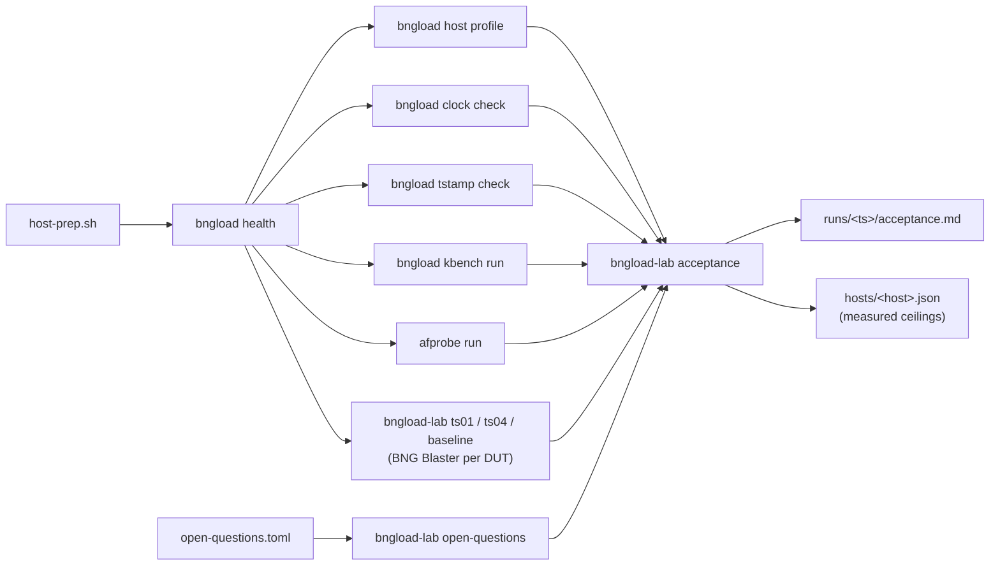

# Phase 0 — requirements and lab validation

From the [design roadmap](../design/bngload-technical-design.md#15-implementation-roadmap):

> **Deliverables:** signed-off requirements; lab topology (generator host,
> DUTs, AAA, switch or direct cables, TAP); host profile with NIC timestamp
> support verified; DUT configs; baseline runs with BNG Blaster; measured
> kernel costs for netns/TUN creation; answers to section 17 open questions.
>
> **Acceptance criteria:** HW stamps verified on RX and TX; chrony meets MR-2;
> BNG Blaster TS-01/TS-04-equivalent numbers recorded per DUT; every open
> question has an owner.

## Documents

| Document | Use it to |
| --- | --- |
| [runbook.md](runbook.md) | run Phase 0 on a lab host, step by step |
| [acceptance.md](acceptance.md) | check off the criteria and deliverables and record sign-off |
| [requirements-traceability.md](requirements-traceability.md) | see which design requirement each tool, check and test covers |
| [open-questions.toml](open-questions.toml) | the open-question register (design 17.7) — assign owners here |

## How the pieces fit

Every tool writes a `bngload.report/v1` JSON envelope; the acceptance step
reads only those files, so a run directory can be archived and re-evaluated.

## What the Phase 0 numbers mean — and do not mean

- **Timestamps.** `tstamp check` proves that the NIC stamps the generator's
  own frames on both RX and TX. It measures one-way latency across a cable
  (hardware: same PHC only, MR-1), not DUT latency.
- **I/O ceiling.** `afprobe` measures raw AF_PACKET frame rates with no
  protocol work. It is an upper bound for any engine on that host and a
  reference for the Go engine; it is not the generator ceiling of design 5.6
  (that is TS-16 against the reflector, Phase 6).
- **BNG Blaster baselines.** TS-01/TS-04 *equivalents*: BNG Blaster reports
  aggregate setup time and rate, not per-session phase latencies, and runs
  without bngload's generator health gate. They size the DUTs, answer open
  question 8 and give a first `R_max`; bngload's own TS-01/TS-04 replace
  them from Phase 6.
- **kbench.** Costs of the optional kernel-context tiers (design 2.3): how
  many per-session namespaces/TUNs the host can afford and how fast.
