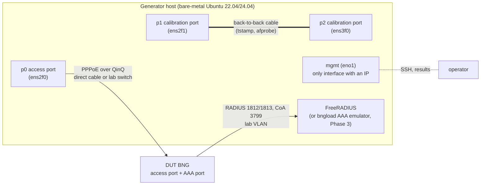

# Phase 0 lab topology

Phase 0 needs one generator host, at least one DUT and an AAA server. The
topology below is the reference; record deviations in the host profile and in
the DUT's lab spec (`lab/blaster/<dut>.toml`).

| Link | Purpose | Requirements |
| --- | --- | --- |
| p0 → DUT access port | PPPoE sessions (BNG Blaster now, bngload later) | allowlisted, no IP address (SR-11, SR-19); MTU ≥ 1508 for QinQ with MRU 1492; RX VLAN offload off |
| p1 ↔ p2 | timestamp self-test (`bngload tstamp check`) and I/O ceiling (`afprobe`) | same NIC model as p0, ideally the same card; hardware timestamping on both (MR-3) |
| DUT ↔ AAA | RADIUS authentication and accounting | lab VLAN/VRF with no route to production (SR-23); RADIUS client secret per DUT |
| mgmt | SSH, reports | the only interface with an IP address |

## Choices to record

- **Direct cable or switch.** A direct cable is preferred. With a switch, record
  its drop counters before and after every run (design 5.6, path separation)
  and make sure it is not learning-limited for thousands of MACs.
- **Timestamp ports.** If p0 itself supports hardware stamps but no second
  port of the same model is free, run `bngload tstamp check` between p0 and a
  second port *before* cabling p0 to the DUT, then re-cable.
- **AAA placement.** On the generator host (shares the clock, simplest) or a
  separate host (record it; cross-host AAA timing needs PTP, MR-5).
- **Clock.** chrony on the generator host (MR-2); PTP (`ptp4l`/`phc2sys`) only
  if the lab has a grandmaster — answers open question OQ-05.

## Addressing used by the example configs

All addresses are from documentation or lab-only ranges; replace them with
your lab plan.

| What | Example |
| --- | --- |
| DUT AAA-facing address (NAS-IP) | 192.0.2.1 |
| AAA server | 192.0.2.10 |
| Subscriber IPv4 pool | 100.64.0.0/14 (shared address space, lab only) |
| Subscriber IPv6 prefixes | fc00::/7 ULA ranges |
| Access VLANs | S-VLAN 100–199, C-VLAN 1–4000 |
